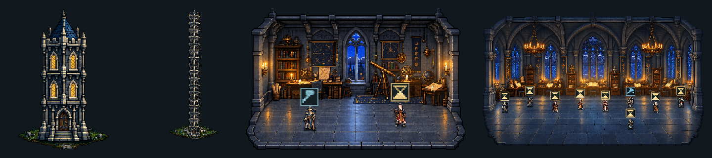

# Task Tower — Башня агентов

Task Tower — прозрачный UI-оверлей для Codex: проекты становятся башнями, сессии — этажами, агенты — сотрудниками внутри комнат. В книжках рядом доступны задачи, исполнители и история Beads; разработка ведётся через Superpowers и существующий Codex.



*Иллюстрации на основе пользовательских скриншотов: фон удалён, изображения приведены к общему масштабу. [Оригиналы и описание обработки](docs/screenshots/README.md).*

## 1. Подготовить окружение

Для настольного оверлея нужны:

- Windows, Windows PowerShell 5.1 с WPF и установленный WebView2 Runtime.
- Codex и Python 3.11+. Скрипт оверлея использует bundled Python Codex: проверьте путь в `overlay/run-html-overlay.ps1`, если установка отличается.
- Установленный Superpowers — для рабочего процесса разработки.
- `bd.exe` и локальный embedded-проект Beads — если нужны задачи и хронология в книжках.

Node.js требуется для тестов и подготовки графики, а не для запуска готового оверлея. Установку программ и авторизацию выполняют отдельно; Task Tower их не создаёт автоматически.

## 2. Скачать проект

```powershell
git clone https://github.com/Sibiya666/task-tower.git
cd task-tower
```

Если клон уже есть, сначала сохраните свои изменения и обновите его из `main`. Дальнейшие команды запускайте из корня Task Tower.

## 3. Настроить рабочую сессию Codex

Если Codex и Superpowers уже настроены, переходите к подключению задач. Для первого запуска укажите настоящий путь к установленному навыку:

```powershell
python bootstrap.py --harness codex --superpowers "C:/path/to/using-superpowers/SKILL.md" --configure-only
python bootstrap.py --launch
```

Первая команда сохраняет локальную настройку, вторая явно запускает обычную сессию. Замените пример пути своим. [Подробности bootstrap и поддерживаемые адаптеры](docs/bootstrap.md).

## 4. Подключить Beads к книжкам

Используйте свой существующий embedded-проект Beads. Для нового проекта выполните отдельную инициализацию по [инструкции Beads-источника](docs/local-beads-books.md); существующую базу повторно не инициализируйте.

Включите журнал **до** работы, которую хотите видеть в хронологии. Пример с отдельным проектом:

```powershell
Push-Location 'C:/Projects/my-project'
& 'C:/Tools/beads/bd.exe' config set events-journal true
Pop-Location
```

Создайте приватный `C:/Private/task-tower-beads.json` вне Git; все пути и namespace ниже замените своими:

```json
{
  "version": 1,
  "executable": "C:/Tools/beads/bd.exe",
  "projects": [
    {
      "id": "my-project",
      "repository": "owner/repository",
      "directory": "C:/Projects/my-project"
    }
  ]
}
```

В той же PowerShell-сессии, из которой запустите оверлей:

```powershell
$env:TASK_TOWER_BEADS = 'C:/Private/task-tower-beads.json'
```

Без этого подключения можно наблюдать сессии Codex, но задачи Beads в книжках не появятся. Адаптер читает существующие данные; переноса GitHub Issues или другой базы не выполняет.

## 5. Запустить оверлей

```powershell
.\overlay\start-tower.cmd
```

Чтобы одновременно открыть установленное desktop-приложение Codex, вместо этого входа используйте `overlay/launch-codex-tower.ps1`. Ярлык Task Tower должен указывать на этот launcher.

Оверлей читает локальные данные Codex; bootstrap-сессии других harness он пока не показывает. [Управление, интерьеры и источники данных](docs/overlay-usage.md).

## 6. Работать с башнями и книжками

- Нажмите этаж, чтобы войти в комнату. **←** возвращает к башням, **◆** закрепляет окно, **×** закрывает.
- Перетаскивайте окно за рисунок; колесо прокручивает поле башен. Правый клик открывает настройки мира, освещения и погоды.
- **Ctrl+B** или пункт «Книги проекта» в меню открывает книжки. Выберите проект и задачу, затем «Подробнее».
- В деталях Beads видны исходный ID, исполнитель, состояние, зависимости и хронология. Публичный блок результата, если он записан в источнике, показывает сведения Beads; `closed` и ссылки сами по себе не подтверждают независимую приёмку.
- При изменении источника обновите книжки. Неполная история, устаревший снимок и ошибка источника обозначаются явно.

Для выполнения работы выберите разрешённую задачу Beads, проверьте готовность и владельца, получите native claim с readback и следуйте Superpowers. Принятие результата проходит через отдельный review, настоящий PR/CI и проверку точного main. Books отображает результат и не запускает этот процесс по нажатию на карточку.

## Развёртывание без UI — отдельно

Для Linux Docker-оркестратора и host-коннектора есть [пошаговая инструкция headless-развёртывания](docs/runtime/headless-operation.md#linux-docker-deployment-stage-6). Она описывает сборку, приватную конфигурацию, отдельные persistent volumes Beads/runtime и явный запуск существующего Codex на хосте. Этот сценарий не нужен для настольного оверлея; перенос канонического бэклога и автозапуск службы не выполняются по умолчанию.

## Документация

[Открыть документацию Task Tower](docs/README.md) — устройство компонентов, подробная эксплуатация, действующие правила разработки и историческая справка.
