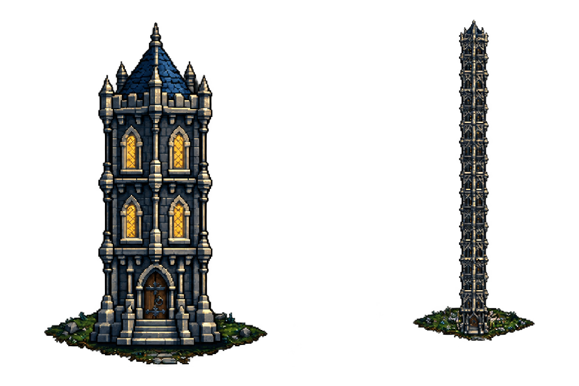
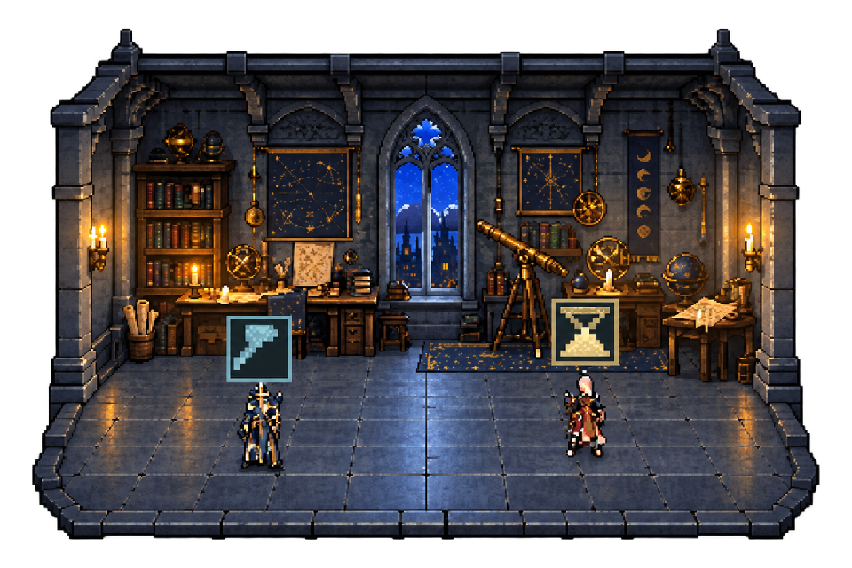
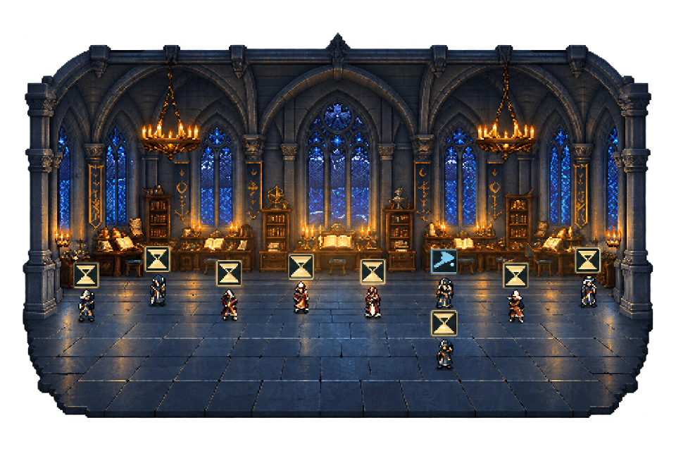

# Task Tower — Башня агентов

Один проект для организации агентной разработки и её визуализации. Проекты представлены фэнтезийными башнями, сессии — этажами, агенты — сотрудниками внутри помещений.

Сейчас работают **прозрачный Windows-оверлей** с локальными данными Codex и **CLI аудита готовности проектов**. Очередь задач, запуск моделей, автоматические слияния и интерфейс трёх книг пока описаны в архитектуре, но не реализованы. Оверлей наблюдает за работой и сам не запускает агентов.

## Скриншоты

Реальные пользовательские скриншоты приложения с обработкой фона для документации. Экспорты — прозрачные PNG на одинаковом холсте 960×640 с сохранением пропорций. [Исходники и описание обработки](docs/screenshots/README.md).



**Обзор проектов.** Башня соответствует проекту, этаж — сессии. Свет в окнах показывает работу основного агента или субагентов. Высокие башни равномерно уменьшаются, как объекты вдали.



**Небольшая команда.** Цельный кабинет астролога с двумя сотрудниками. Инструмент обозначает работу, песочные часы — ожидание. У каждого персонажа собственная подсказка с именем, ролью и состоянием.



**Большая команда.** Готический зал с общим сводом и единым полом. Все сотрудники отображаются внутри помещения; мебель остаётся в глубине и у стен.

## Запуск

Windows, Windows PowerShell 5.1 с WPF, WebView2 Runtime и Python 3.11+.

```powershell
.\overlay\start-tower.cmd
```

`overlay/launch-codex-tower.ps1` открывает установленное приложение Codex и оверлей. Ярлык рабочего стола указывает на него. Python ищется в bundled runtime Codex: при переносе проверьте путь в `overlay/run-html-overlay.ps1`. Node нужен для тестов и подготовки графики, а не для запуска готового оверлея.

Нажмите этаж, чтобы войти. ← возвращает к башням, ◆ закрепляет окно, × закрывает. Оба экрана перетаскиваются за рисунок; движение от 5 пикселей считается перетаскиванием. Поле башен прокручивается колёсиком.

## Интерьеры и агенты

- Четыре размерности: кабинет для 1–4 сотрудников, мастерская для 5–8, зал для 9–16, большое помещение для 17+. По три цельных скина каждой размерности — всего 12.
- Размер выбирается **при входе** и сохраняется до выхода. Вариант закреплён по ID сессии. Новые агенты появляются в текущем помещении без смены фона.
- Все сотрудники видимы, скрытого остатка `+N` нет. Персонажи распределены по полу и рисуются с учётом глубины.
- У разработчиков, проверяющих и исследователей/дизайнеров по четыре облика. Главный агент — маг. Модель стабильно выбирается по ID.
- Анимированы дыхание, рабочие движения, инструмент, песочные часы, облака за стеклом и свет свечей. Учитывается системное уменьшение движения.
- Башни сохраняют участки на поле и занимают несколько рядов. Наведение слегка осветляет камень выбранного этажа.

## Данные

Сборщик раз в 3 секунды читает локальную `~/.codex/state_5.sqlite` в режиме `mode=ro` и JSONL-журналы. База, журналы и настройки Codex не изменяются; их содержимое не отправляется в сеть. Внутренние форматы Codex не являются стабильным публичным API.

Источник старше 12 секунд считается недоступным; активный журнал без событий более 180 секунд получает состояние «Нет свежих событий». В этих случаях свет не изображает подтверждённую работу. Guardian-сессии скрыты. Вложенные субагенты относятся к родительской сессии; проекты определяются по связям Codex, корням репозиториев и Git worktree.

Каждое окно получает свой сборщик и `overlay/runtime/snapshot-<pid>.json`; актуальный путь указан в `overlay/runtime/overlay-source.json`. Закрытие окна завершает только его сборщик. Runtime, профили браузера и приватные привязки проектов исключены из Git.

## Структура

```text
task_tower/       CLI аудита готовности (Python standard library)
tests/           тесты CLI
examples/        манифесты проектов
overlay/         Windows-хост, сборщик, UI, графика и тесты оверлея
  web/           HTML/CSS/Canvas и подготовленные PNG
  assets/        исходники графики и промпты
  vendor/        WebView2 SDK и лицензии PixelFX
docs/            архитектура, планы, отчёты, скриншоты
```

## CLI готовности

```powershell
python -m task_tower audit --project C:/path/to/project --manifest examples/dialoid.project.json --output ../runtime/readiness.json
```

Без `--run-checks` выполняется аудит; с ним — явно запрошенные команды манифеста с ограничением времени и жизненного цикла процессов. Это не sandbox и не разрешение на автономное слияние. Коды выхода и ограничения: [документация CLI](docs/readiness.md).

## Проверки

```powershell
python -m unittest discover -s tests -v
Push-Location overlay
python -m unittest -v
node --test test-web.cjs test-room-skins.cjs
powershell.exe -NoProfile -ExecutionPolicy Bypass -STA -File overlay.ps1 -SmokeTest
Pop-Location
```

Браузерным тестам нужны Playwright, Sharp и установленный Edge. Пути к bundled Node-модулям Codex сейчас машинно-зависимы. Нативная проверка использует реальные данные, сохраняет PNG в игнорируемую `overlay/runtime/` и закрывает тестовое окно.

## Разработка

См. [AGENTS.md](AGENTS.md), [архитектуру](docs/superpowers/specs/2026-11-01-agent-development-architecture-design.md) и [устройство оверлея](overlay/README.md). Не выдавайте планы оркестрации за реализованные возможности.

Графика создана через imagegen; исходники и промпты находятся в `overlay/assets/`. Эффекты PixelFX имеют MIT license и дополнительные атрибуции в `overlay/vendor/pixelfx/`. Условия WebView2 SDK сохранены в `overlay/vendor/webview2/sdk/`. Лицензия всего проекта отдельно не назначена.
