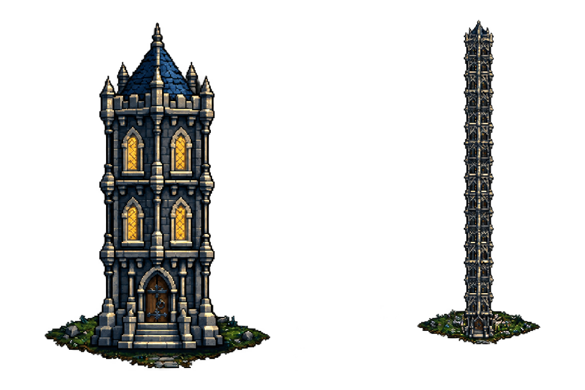
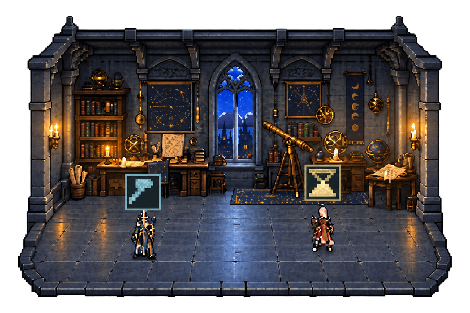
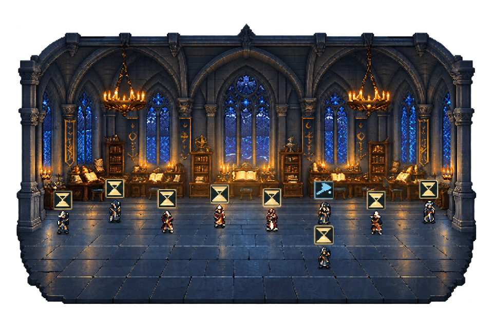

# Эксплуатация настольного оверлея

[Краткая последовательность запуска](../README.md) · [Документация](README.md)

## Запуск

Выбор установленного Codex / Claude Code / OpenCode / собственного harness после clone:

```sh
python bootstrap.py
```

Python 3.11+; также доступны `start.cmd` на Windows и `sh start.sh` на macOS/Linux. Выбор и контекст Superpowers сохраняются локально. [Настройка, ограничения и первая задача Task Tower](bootstrap.md).

Windows, Windows PowerShell 5.1 с WPF, WebView2 Runtime и Python 3.11+.

```powershell
.\overlay\start-tower.cmd
```

`overlay/launch-codex-tower.ps1` открывает установленное приложение Codex и оверлей. Ярлык рабочего стола указывает на него. Python ищется в bundled runtime Codex: при переносе проверьте путь в `overlay/run-html-overlay.ps1`. Node нужен для тестов и подготовки графики, а не для запуска готового оверлея.

Нажмите этаж, чтобы войти. ← возвращает к башням, ◆ закрепляет окно, × закрывает. Оба экрана перетаскиваются за рисунок; движение от 5 пикселей считается перетаскиванием. Поле башен прокручивается колёсиком.

Открытая комната сдвигается внутрь рабочей области текущего монитора с учётом панели задач и DPI. При возврате восстанавливаются прежние координаты и размер обзора, а также прокрутка поля башен. Перемещение комнаты не меняет сохранённое положение обзора; при недоступности прежнего места окно сдвигается в доступную рабочую область.

Оверлей также проверяет границы после перетаскивания/изменения размера и перед открытием настроек. Сохранённая позиция за пределами рабочей области корректируется; недоступные части окна и панели не сохраняются намеренно.

## Интерьеры и агенты

- Четыре размерности: кабинет для 1–4 сотрудников, мастерская для 5–8, зал для 9–16, большое помещение для 17+. По три цельных скина каждой размерности — всего 12.
- Размер выбирается **при входе** и сохраняется до выхода. Вариант закреплён по ID сессии. Новые агенты появляются в текущем помещении без смены фона.
- Все текущие сотрудники видимы, скрытого остатка `+N` нет. Новые агенты заходят на этаж; завершившие задачу выходят и исчезают. Уже завершённые исторические агенты при открытии комнаты не показываются. Персонажи распределены по полу и рисуются с учётом глубины.
- Песочные часы означают явное ожидание вашего решения по незакрытому запросу ввода/подтверждения. Обычный простой показан нейтральными точками. Текстовые вопросы в произвольном ответе не распознаются эвристически; без структурированного события ожидание не выдумывается.
- У разработчиков, проверяющих и исследователей/дизайнеров по четыре облика. Главный агент — маг. Модель стабильно выбирается по ID.
- Анимированы дыхание, рабочие движения, инструмент, песочные часы, облака за стеклом и свет свечей. Учитывается системное уменьшение движения.
- Башни сохраняют участки на поле и занимают несколько рядов. Наведение слегка осветляет камень выбранного этажа.
- Участки привязаны к правому краю, ближе к управлению, без пустой третьей колонки при двух проектах. При появлении нового работающего агента на открытом обзоре персонаж подходит к двери башни и входит; начальная загрузка и повторные обновления не воспроизводят этот вход.

### Мир, освещение и погода

Правый клик по сцене открывает компактные настройки. Постоянные кнопки управления остаются прежними. Освещение по умолчанию следует местному времени: рассвет 06–08, день 08–18, сумерки 18–20, ночь 20–06. Можно вручную выбрать день или ночь. Переключение плавное, без непрозрачной подложки поверх рабочего стола.

Солнце или луна на сцене показывают фазу освещения. В настройках есть строка «Сейчас: …» с местным временем или пометкой ручного режима. Сетка адаптируется к ширине окна: до трёх колонок, без обрезания башен по горизонтали; следующие ряды доступны вертикальной прокруткой.

Погода выбирается вручную: ясно, облачно, дождь, туман. Используются прозрачные пиксельные эффекты PixelFX; облака находятся за башнями, осадки не перехватывают мышь. Эффекты можно отключить. При системном уменьшении движения показывается статичный кадр.

Башни с более чем восемью сессиями в обзоре имеют компактный дальний силуэт из четырёх декоративных секций. Это уровень детализации обзора, а не удаление/объединение чатов: рядом показано настоящее число этажей. Нажмите плашку «N этажей» для полного списка сессий или переключения на изображение всех этажей. Подсветка декоративной секции означает активность хотя бы одной соответствующей реальной сессии.

Башня скрывается после 30 минут подтверждённого простоя. В настройках доступны 10/30/60 минут или отключение скрытия, а также «Показывать скрытые башни». Активность и ожидание решения возвращают/сохраняют башню; неизвестное состояние, ошибка и устаревший источник не запускают скрытие. Проекты, чаты и их данные не удаляются; участок сохраняется. Настройки и время простоя сохраняются только в локальном профиле WebView2.

## Данные

Сборщик раз в 3 секунды читает локальную `~/.codex/state_5.sqlite` в режиме `mode=ro` и JSONL-журналы. База, журналы и настройки Codex не изменяются; их содержимое не отправляется в сеть. Внутренние форматы Codex не являются стабильным публичным API.

Источник старше 12 секунд считается недоступным; активный журнал без событий более 180 секунд получает состояние «Нет свежих событий». В этих случаях свет не изображает подтверждённую работу. Guardian-сессии скрыты. Вложенные субагенты относятся к родительской сессии; проекты определяются по связям Codex, корням репозиториев и Git worktree.

Каждое окно получает свой сборщик и `overlay/runtime/snapshot-<pid>.json`; актуальный путь указан в `overlay/runtime/overlay-source.json`. Закрытие окна завершает только его сборщик. Runtime, профили браузера и приватные привязки проектов исключены из Git.

## Скриншоты

Реальные пользовательские скриншоты приложения с обработкой фона для документации. Экспорты — прозрачные PNG на одинаковом холсте 960×640 с сохранением пропорций. [Исходники и описание обработки](screenshots/README.md).



**Обзор проектов.** Башня соответствует проекту, этаж — сессии. Свет в окнах показывает работу основного агента или субагентов. Высокие башни равномерно уменьшаются, как объекты вдали.



**Небольшая команда.** Цельный кабинет астролога с двумя сотрудниками. Инструмент обозначает работу, песочные часы — ожидание. У каждого персонажа собственная подсказка с именем, ролью и состоянием.



**Большая команда.** Готический зал с общим сводом и единым полом. Все сотрудники отображаются внутри помещения; мебель остаётся в глубине и у стен.
