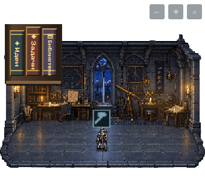
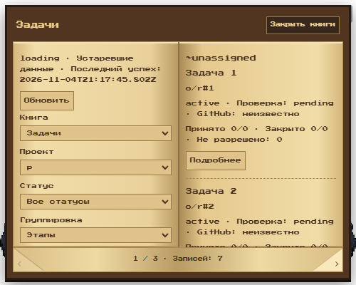
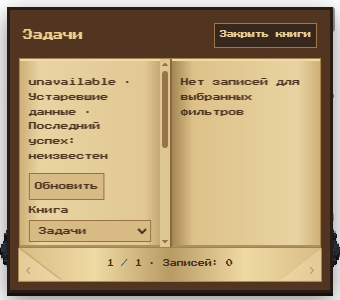

# Floor bookshelf verification

User-approved scope: three spine-facing books on the selected floor; Ideas, Tasks and Project library open a warm beige-yellow parchment spread. Folded bottom corners navigate records. Local Press Start 2P includes Cyrillic, with its OFL license beside the font. This is a DOM/CSS presentation of existing read-only Books data, not a task engine or migration.

## Behavior and limitations

- Shelf is absent from overview. Existing five-pixel drag gesture works on the scene and shelf; dragging suppresses book opening.
- Left page contains filters and source health, right page contains up to three records or details. Pages scroll independently; both folded corners stay inside a 300–340px compact window. Escape and focus restoration remain available.
- A floor's Codex project ID is not assumed to match a configured Books project ID. Unknown scope shows no records until the user explicitly selects a configured project. That explicit mapping stays in local WebView storage; empty/partial source frames never broaden the scope.
- Page/open animation respects reduced motion. Existing source URL allowlist, private host boundary, DOM text rendering, freshness/proof semantics and transparency are unchanged.
- The Beads adapter still does not create local Markdown ideas/library data. The shelf does not invent records for empty books.

## Verification ledger

- Baseline Books browser: 13 passed. New shelf test first failed because the shelf did not exist.
- New scope regression first failed with two unrelated records, then passed after scope/mapping correction.
- Books browser + shelf: 15 passed; independently repeated by `review_bookshelf` with no remaining blockers.
- Combined existing overlay browser/policy run: 44/45 initially; existing drag test detected shelf interception. Removed pointer interception; rerun `test-web.cjs` plus shelf: 3/3 passed. Remaining unchanged tests had passed in the combined run.
- Overlay Python: 18 passed.
- Actual Windows composition WebView2 `overlay.ps1 -SmokeTest`: PASS, including Books source checks, narrow bounds, transparency and native controls. A repeated run failed its fixed four-second live-room startup check under parallel test load; the separate repeat passed. Do not treat old result files as a new run.
- Full product Python suite: running; final result recorded before integration.
- `git diff --check`: passed.

## Screenshots

These are actual UI captures; the records/rooms in browser fixtures are synthetic test data, not evidence of live project results. PNG alpha is preserved.

Native captures exercise the real Windows/WebView2 host with public fixture messages and synthetic DOM keyboard events; they are not hardware keyboard or human acceptance evidence.
