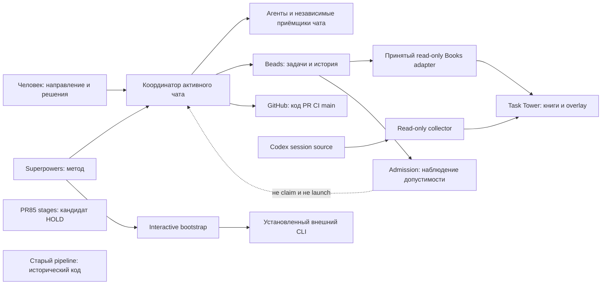
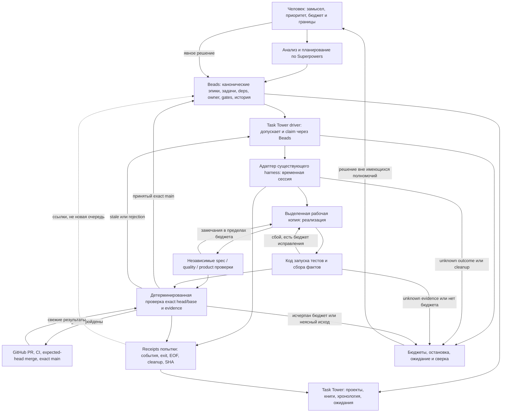

# Собираем Task Tower вокруг проверенного исполнения

> **ИСТОРИЯ / ЗАМЕНЕНО решением 2026-11-06.** Действующий маршрут: [Beads + Superpowers + готовый Codex](../current-direction.md). Прежние Windows-квалификация, план B и порядок этапов ниже не действуют. Весь последующий текст, включая старые approvals, слова «текущая authority» и «следующий шаг», сохранён как датированный материал; не возобновлять по нему исполнение или claims. Независимые проверки, безопасность и PR/main gates сохраняются в актуальном AGENTS.md.

**Решение пользователя, 2026-11-05:** предложенное ниже архитектурное направление согласовано; разрешён переход к спецификации и выполнению нового плана через Superpowers. Исходная исследовательская формулировка DRAFT ниже сохранена как контекст предложения. Согласование не является приёмкой runtime, отменой шестиролевой квалификации или разрешением на ACL. Актуальный порядок — [A–E и сопоставление существующих задач](2026-11-05-task-tower-proposed-backlog.md).

**DRAFT для совместного архитектурного решения, 2026-11-05.** Рекомендуем развивать собственный Task Tower: Beads хранит задачи, зависимости, владельцев и историю; Superpowers задаёт анализ, декомпозицию и разработку; установленный harness исполняет ограниченные агентные работы; Task Tower связывает их с интерфейсом, проверками и управлением процессами. Уже принятые Books, overlay, admission и CI следует сохранить. Главная незакрытая граница — не отсутствие ещё одного планировщика, а пригодность конкретного исполнителя на доступной Windows 10 и его подключение к полезному сквозному сценарию. Поэтому следующий этап должен сначала доказать один небольшой путь от согласованной задачи до проверенного результата, а не расширять универсальный controller. AgentsRoom и другие продукты здесь служат источниками сравнения, **не предлагаются к внедрению вместо Task Tower**. Документ не запускает разработку, не меняет текущие gates и не закрывает задачи.

## Рабочие компоненты уже есть; автономное исполнение ещё не принято

База анализа — принятый main **`ab91f551fb10e18622e2251e7d4709a2f2c380fb`**. Отдельно исследован draft PR85 **`cf560243756026fd0ea1a6f585e2fe16a33ddfb9`**. Это разные состояния продукта: наличие исходников и зелёного обычного CI у кандидата не превращает его в принятую возможность. Live-процессы UI, приватные настройки и Beads DB в этом анализе не проверялись. «Работает» ниже означает компонент с существующей приёмкой, а не новый запуск приложения. ([Инвентаризация с проверкой SHA](#evidence), [принятое направление](https://github.com/Sibiya666/task-tower/blob/ab91f551fb10e18622e2251e7d4709a2f2c380fb/AGENTS.md#L5-L17)).

| Компонент | Подтверждённая возможность | Существенная граница |
| --- | --- | --- |
| Overlay проектов, сессий и агентов | Read-only коллектор и визуализация существующих Codex-сессий | Наблюдение за сессией не создаёт исполнителя и не подтверждает качество результата |
| Books | Принятый локальный read-only адаптер Beads: задачи, зависимости, владельцы, хронология | `closed` — состояние источника; неполная история явно остаётся неполной |
| Admission `.1` | Принятая проверка допустимости на pinned source/policy; bounded `ready/show` | Не делает claim и не запускает модель |
| Interactive bootstrap | Реально готовит и запускает внешний CLI, передаёт закреплённые инструкции | Его capabilities не обещают autonomous merge, resume и independent review |
| GitHub CI и приёмка | Реальные PR/main проверки, exact SHA, независимые вердикты; отдельная docs-route | Docs-validation не равна выполнению runtime-тестов; Beads-close пока координируется чатом |
| PR85 stages | Написаны Beads port, роли, переходы, host checks и runner | Обязательная native qualification HOLD; не принято в main |
| Старый pipeline/worker | Исходники и история сохранены | Исторический путь не является текущим Beads-engine и не должен возобновляться |

Таблица основана на закреплённых [Books](https://github.com/Sibiya666/task-tower/blob/ab91f551fb10e18622e2251e7d4709a2f2c380fb/task_tower/beads_books.py#L53-L145), [admission](https://github.com/Sibiya666/task-tower/blob/ab91f551fb10e18622e2251e7d4709a2f2c380fb/task_tower/beads_admission.py#L232-L344), [harness capabilities](https://github.com/Sibiya666/task-tower/blob/ab91f551fb10e18622e2251e7d4709a2f2c380fb/task_tower/harness.py#L12-L14), [правилах CI](https://github.com/Sibiya666/task-tower/blob/ab91f551fb10e18622e2251e7d4709a2f2c380fb/AGENTS.md#L22-L29) и [candidate status](#evidence). PR84 receipt подтверждает admission и явно исключает stage execution/unattended readiness. ([PR84 acceptance](#evidence)).

На схеме стрелки из чата означают текущую организацию работы, **не поставленный сервис Task Tower**. Это различие объясняет часть ожиданий пользователя: успешно выполненные действия координатора не становятся автоматически возможностями установленного приложения.

Узкий аудит обнаружил конкретный дефект порядка работы. План разрешал реализацию до доступности обязательного профиля; затем частный отказ MXC/файловой схемы был слишком широко объяснён как невозможность Windows 10. Следующей границей оказался транспорт `request.json` внутри закрытой evidence-директории. Это не доказательство, что проверки излишни: независимые reviewers находили реальные ошибки cleanup, cancellation и передачи замечаний. Это аргумент проверять критическое интеграционное предположение раньше зависимого каркаса. ([Исходный анализ процесса](#evidence), [независимая аналитическая приёмка с ограничениями](#evidence)).

## Готовые инструменты дают механизмы; их гарантии нужно сопоставлять

Beads уже умеет представлять workflow как эпик с дочерними задачами и зависимостями; formula добавляет шаблон, а не обязательный второй движок. Документация описывает атомарный claim, guarded updates, leases и gates. Но хранение графа не запускает произвольные команды: документация molecules отдельно отмечает отсутствие полного runtime expansion. Следовательно, Beads должен оставаться источником готовности и владения, а небольшой driver — выполнять разрешённый шаг и приносить доказательство. ([Molecules](https://github.com/gastownhall/beads/blob/0a004ca47fdff58126bf6e46daf4a08e0abe229c/docs/workflows/molecules.md), [update](https://github.com/gastownhall/beads/blob/0a004ca47fdff58126bf6e46daf4a08e0abe229c/docs/cli-reference/update.md)).

**Эти upstream-возможности ещё не квалифицированы для установленного bd.exe.** Исследован commit `0a004ca…`, а локальный пилот использовал 1.3.4. Нельзя молча обновлять пакет или проектировать обязательный путь вокруг команды, которой установленная версия не имеет. Встроенные `gh:run`/`gh:pr` gates также слабее нашей приёмки: успешный run или merged PR сами по себе не доказывают независимость reviewer, exact head/base и exact-main artifact. Нужен проверяющий нашего контракта, а не дублирующий task DAG. ([Gate reference](https://github.com/gastownhall/beads/blob/0a004ca47fdff58126bf6e46daf4a08e0abe229c/docs/cli-reference/gate.md), [исследование контракта и версий](#evidence)).

OpenAI документирует несколько разных границ. `codex exec` предназначен для ограниченных неинтерактивных работ и выдаёт структурированные события; Codex SDK управляет локальными threads; App Server предоставляет более подробный протокол событий и approvals для собственного клиента. Agents SDK выполняет агентный loop, но storage, deployment, инструменты и решения о разрешениях остаются у приложения. Ни одно из этих названий не доказывает готовый безопасный адаптер именно для текущей установленной сборки. **Рекомендуется сначала узкий адаптер существующего harness; смена SDK не является архитектурной целью.** ([Non-interactive mode](https://learn.chatgpt.com/docs/non-interactive-mode), [Codex SDK](https://learn.chatgpt.com/docs/codex-sdk), [App Server](https://learn.chatgpt.com/docs/app-server), [Agents SDK](https://developers.openai.com/api/docs/guides/agents/sdk)).

Официальная Windows-матрица называет актуальную Windows 10 best effort, Windows 11 recommended и отдельно оговаривает совместимость MXC. Она не подтверждает прежний общий тезис «изоляция на Windows 10 невозможна». Одновременно локальные успешные примитивы не закрывают сочетание cancellation, permission lifecycle и сосуществования клиентов: прочитанный санитизированный локальный статус оставляет их неквалифицированными. Нужны минимальные гарантии выбранного сценария и их проверка, а не новая ОС как предположение. ([Windows sandbox](https://learn.chatgpt.com/docs/windows/windows-sandbox), [Win10 status](#evidence)).

Рынок уже содержит не только терминальные панели, но и workflow/review/control системы. Сравнение ниже показывает полезные границы для собственного продукта. Все характеристики — **документированные заявления поставщиков**, прочитанные 2026-11-05, а не наши runtime-испытания. Нигде не доказана готовая совместимость с нашим Beads/Superpowers/Windows10/exact-main контрактом.

| Референс | Что документировано и чему стоит учиться | Что не следует из этого |
| --- | --- | --- |
| AgentsRoom | Проекты, Teams с handoff/check commands, separate sessions и расписания; полезна наглядность ролей/ожиданий. [Teams](https://agentsroom.dev/features/teams), [schedules](https://agentsroom.dev/features/scheduled-tasks) | Это не предложение внедрения; Windows installer не квалифицирует нашу изоляцию |
| Vibe Kanban | Task/workspace/agent, несколько репозиториев и Git/review UI. [Introduction](https://www.vibekanban.com/docs), [multi-repo](https://www.vibekanban.com/docs/workspaces/multi-repo-sessions) | Его собственные issues не нужны рядом с Beads; worktree не security boundary |
| Superset → Paradev | Проверенный редирект на актуальный продукт: workspaces, внешние агенты, event/schedule automations. [Paradev](https://paradev.com/), [automations](https://paradev.com/automations) | Документирована macOS/experimental Linux, Windows пока отсутствует; missed offline запуск не повторяется автоматически |
| Conductor, Melty Labs | Workspace как единица делегирования, branch/PR как единица интеграции, checks и review UX. [Workflow](https://www.conductor.build/docs/concepts/workflow), [Checks](https://www.conductor.build/docs/reference/checks) | Текущая desktop availability — macOS, не наша Windows10; checkpoint кода не откатывает внешний эффект. [Installation](https://www.conductor.build/docs/installation) |
| OpenHands | UI, SDK и server разделены; Software Factory описывает developer/reviewer и детерминированный watchdog, exact-head checks. [Factory](https://docs.openhands.dev/openhands/usage/use-cases/software-factory), [overview](https://docs.openhands.dev/overview/introduction) | Vendor recipe не доказывает нашу независимую exact-main приёмку или native Windows qualification |
| Codex desktop / SDK / App Server | Наблюдаемые threads/turns/approvals и review; наиболее близкий существующий executor interface. [App Server](https://learn.chatgpt.com/docs/app-server) | Не готовая каноническая delivery-очередь Beads; отдельный review на том же thread не автоматически независим |
| ComposioHQ agent-orchestrator → OrchestratorInc | Проверенный редирект; проектный main-agent, workers/reviewer, daemon и обратная связь CI/conflicts. [Repository](https://github.com/OrchestratorInc/agent-orchestrator), [architecture](https://docs.orchestrator.inc/architecture/) | Документированный Windows installer не устанавливает безопасность нашего профиля или unknown-effect recovery |

Вывод сравнения — заимствовать **task/workspace UX**, различение ролей и детерминированный integration watchdog, сохраняя собственные Beads-данные и пользовательские границы. Установка любого из референсов не предлагается. Нельзя обещать круглосуточную работу от наличия desktop schedules или качество от числа parallel agents. Реализации, производительность и безопасность этих продуктов не испытывались; происхождение сравнения указано в [реестре локальных материалов](#evidence).

Исследованные материалы о harness полезны как источники приёмов, но не как новый фундамент исполнения. Закреплённый Harness² повторно выполняет benchmark-задачи, изменяет harness и выбирает результат; его публичные launchers используют bypass sandbox/approvals и POSIX-механизмы. Это несовместимо с прямым переносом в текущий Windows-контракт. Полезно заимствовать привязку улучшения к наблюдаемой ошибке, идентичность evidence и различение no-change/failure; не переносить launch policy и экспериментальный replay в production. ([Harness² substrate](https://github.com/google-research/harness2/blob/6868817518876de8fd170c6a8354daca273b6191/harness2/substrate/codex.py), [происхождение source trace](#evidence)).

Курс Harness Engineering предлагает полезную карту «инструкции, инструменты, среда, состояние, обратная связь», но его универсальный WIP=1 не следует из закона Литтла, а структурный golden checker не запускает модели. Поэтому число агентов и лимиты нужно выводить из конфликтов, бюджета и измерений Task Tower. Первичная статья OpenAI поддерживает компактную навигацию, доступные проверки и наблюдаемость на конкретном опыте; она не даёт права отменять наши gates. ([Закреплённый курс](https://github.com/justxor/Harness_ru/blob/6420da2d57c901c401fc909354a7f5f7fce81882/README.md#L595-L616), [Little, 1961](https://doi.org/10.1287/opre.9.3.383), [checker](https://github.com/justxor/Harness_ru/blob/6420da2d57c901c401fc909354a7f5f7fce81882/tests/test_harness.py#L267-L296), [OpenAI: Harness engineering](https://openai.com/index/harness-engineering/)).

## Целевая архитектура оставляет один граф задач и отдельные доказательства

**Предлагаемая граница:** Beads хранит durable task control — эпики, зависимости, ready, owner, gates и историю; Superpowers определяет содержательную работу с задачей; Task Tower выбирает разрешённую готовую работу, запускает установленный harness, наблюдает за попыткой и проверяет результат. Runtime receipts хранят факты конкретного процесса и внешнего действия; они не образуют вторую независимо редактируемую очередь. Git остаётся источником кода/спек/планов, GitHub — PR/CI/main. Это PROPOSED, не описание уже принятого автономного продукта.

Контроллер не должен доверять полю `done` от модели. Он проверяет принадлежность результата задаче, источнику и попытке; отличает завершённый процесс от принятой работы; на изменившемся head/base аннулирует допуск старого review. При неизвестном исходе merge/create/claim нужна сверка реального внешнего состояния, а не replay сохранённой команды. Документация durable orchestration показывает общую причину: воспроизводимый control flow и внешние эффекты имеют разные правила, повторная доставка требует dedup. Это требование к нашему контракту, **не рекомендация ставить Azure или иной workflow framework**. ([Deterministic orchestration](https://learn.microsoft.com/en-us/azure/durable-task/common/durable-task-code-constraints), [external events](https://learn.microsoft.com/en-us/azure/durable-task/common/durable-task-external-events)).

Для первой версии рекомендуем одну машину, один явный проект и доступный установленный harness. Embedded Beads не обязывает иметь только один агентный процесс: короткие записи можно последовательно обслуживать, пока независимые работы исполняются; пропускная способность такой схемы ещё не измерена. Количество task slots не равно количеству одновременно запущенных native процессов. Позднее fairness между проектами можно задать отдельной политикой лимитов и очередности, сохраняя semantic ownership и сериализацию merge/main по репозиторию. Ни Beads routing, ни общий пул не наследуют разрешения Task Tower на Diabloid. ([Dolt modes](https://github.com/gastownhall/beads/blob/0a004ca47fdff58126bf6e46daf4a08e0abe229c/docs/architecture/dolt.md), [routing](https://github.com/gastownhall/beads/blob/0a004ca47fdff58126bf6e46daf4a08e0abe229c/docs/multi-agent/routing.md), [текущий repository allowlist](https://github.com/Sibiya666/task-tower/blob/ab91f551fb10e18622e2251e7d4709a2f2c380fb/task_tower/beads_admission.py#L28)).

| Компонент | Рекомендуемое решение | Проверяемая причина |
| --- | --- | --- |
| UI/overlay/Books | Сохранить, дополнить состоянием задачи и попытки | Уже дают пользовательскую ценность; live status не выдавать за acceptance |
| Admission и source identity | Переиспользовать | Принятый ограниченный вход; не превращать observation в ownership |
| PR85 Beads port | Проверить для повторного использования | Уже обращается к native claim/state/heartbeat; новая очередь не требуется |
| PR85 role evidence и host checks | Сохранить полезные инварианты, упростить под выбранный launch contract | Exact source и cleanup нужны; способ передачи файлов не обязан оставаться прежним |
| PR85 phase coordinator | Сопоставить с Beads task/stage graph и Superpowers | Не переписывать автоматически; убрать дублирование лишь после установленного соответствия |
| Транспорт/provider PR85 | Пересмотреть первым | Default CLI не получает квалифицированный concrete runner; успешный helper не завершает этот путь |
| Старый GitHub task engine | Не развивать в target | Не удалять исходники, claims, receipts и пользовательский WIP |
| Огромный handoff как вход | Заменить кратким актуальным указателем и историческими ссылками | Уже найдены stale ACTIVE и конфликт направления между корневым checkout и принятой копией |

Основание решений по кандидату — [Beads port](https://github.com/Sibiya666/task-tower/blob/cf560243756026fd0ea1a6f585e2fe16a33ddfb9/task_tower/beads_stage_port.py#L339-L420), [runner](https://github.com/Sibiya666/task-tower/blob/cf560243756026fd0ea1a6f585e2fe16a33ddfb9/task_tower/beads_stage_roles.py#L769-L847), [default refusal](https://github.com/Sibiya666/task-tower/blob/cf560243756026fd0ea1a6f585e2fe16a33ddfb9/task_tower/beads_stages.py#L559-L599) и [узкий архитектурный аудит](#evidence). Таблица предлагает **component-level reuse**, а не списание уже написанного кода.

## Роли разделяют ответственность, а человек сохраняет продуктовые решения

Нужны различимые обязанности, а не постоянный агент на каждое название. Свежий reviewer с исходной спецификацией и whole diff даёт процедурную независимость от implementer; простая смена роли в том же контексте её не даёт. Отдельный worktree, отдельная сессия и OS-изоляция — разные свойства. Установленный Superpowers описывает fresh implementer, task review по spec/quality и whole-branch review; он не требует шести постоянно работающих OS-процессов. **Однако явное обязательство живых шести ролей для текущей `.2` остаётся в силе до отдельного решения пользователя.** ([Superpowers SDD](#evidence), [текущая спека `.2`](https://github.com/Sibiya666/task-tower/blob/cf560243756026fd0ea1a6f585e2fe16a33ddfb9/docs/superpowers/specs/2026-11-05-beads-superpowers-stages-design.md)).

| Ответственность | Агент | Обычный код / человек |
| --- | --- | --- |
| Аналитик | Изучает проблему, источники, варианты и неизвестности | Человек определяет ценность и приоритет |
| Планировщик | Через Superpowers готовит согласуемую спецификацию и план | Beads хранит утверждённые задачи/зависимости; человек меняет scope |
| Разработчик | Реализует ограниченную задачу в своей копии | Driver контролирует workspace, бюджет и жизненный цикл |
| Spec acceptor | Независимо сопоставляет результат и требования | Код связывает вывод с версией критериев и SHA |
| Quality acceptor | Проверяет whole diff, риски и взаимодействия | Не подменяет собственную независимость исправлением того же diff |
| Test verifier | Проектирует/объясняет проверки при необходимости | Команды, exit, tested SHA, CI и cleanup проверяются механически |
| Product acceptor | Оценивает видимое поведение по согласованному сценарию | Человек принимает спорные UX/gameplay решения и существенный риск |
| Integrator/operator | Агент разбирает неоднозначные сбои | Код проверяет ownership/gates, merge/main, бюджеты и dedup; человек разрешает чрезвычайные действия |

Таблица — предлагаемое распределение, не новый обязательный восьмиагентный конвейер. Для простой задачи spec/quality оценки могут выполняться пропорционально объёму в рамках утверждённого процесса, но implementer не принимает себя. Тестовый запуск не следует повторять потому, что появился новый reviewer: повтор оправдан изменением источников, дефектом evidence или необходимой интеграционной проверкой. Выбор модели и аккаунта здесь не меняется.

Человек задаёт продуктовый замысел, приоритеты, границы автономии и бюджет. Внутри уже выданной авторизации не требуется подтверждать каждую рутинную команду. При новом security/ACL/auth scope или изменении цели система показывает **конкретное подготовленное решение**, его отличие от прежнего согласия и последствия. `waiting_ci`, `needs_decision`, `needs_permission`, `failed` и `blocked_external` должны быть разными видимыми состояниями. Ожидание не должно занимать модельный процесс; молчание не считается согласием. ([Guardrails and human review](https://developers.openai.com/api/docs/guides/agents/guardrails-approvals), [пользовательская граница решения](#evidence)).

Для Diabloid такая схема должна дойти дальше «CI зелёный»: воспроизводимая сборка, реальный запуск игры, согласованные gameplay-сценарии, наблюдаемое поведение и артефакты проверки. Проверяющий различает автоматизируемый критерий и субъективное продуктовое решение. Сейчас в этом аудите не изучены движок, build chain и сама игра; нельзя заранее обещать конкретные тесты или считать управление другими проектами уже разрешённым.

## Следующий backlog должен доказать один полезный путь

Рекомендуем согласовать **локальный управляемый вертикальный сценарий**: пользователь задаёт небольшую цель; Superpowers помогает уточнить её и сформировать задачи в Beads; одна допустимая задача получает настоящего исполнителя; независимый reviewer и тесты проверяют результат; действующие PR/main gates подтверждают поставку; книга показывает историю и точную причину остановки либо завершения. Никакая стадия не должна подменяться синтетической записью. Первый полезный результат — уменьшение ручной координации при сохранении доказательств, а не максимальное число ролей и настроек.

Ниже **проект последовательности эпиков**, не созданные канонические карточки. После архитектурного решения каждый выбранный эпик проходит Superpowers design → review → согласованный plan → небольшие Beads-задачи. Старый `.2–.7` список не переносится механически: существующий код и требования сопоставляются с этим сценарием, а расхождения явно решаются.

| Порядок | Предлагаемый эпик | Критерий результата и stop condition |
| --- | --- | --- |
| A | Единый продуктовый контракт и карта ответственности | Один current/target документ, точный Windows10 launch/privacy contract и актуальный вход в репозиторий. Не писать зависимый runtime при неопределённом обязательном provider |
| B | Один квалифицированный исполнитель установленного harness | Реальная ограниченная задача, проверенные входы/выходы, отказные случаи, cancellation/cleanup и независимая приёмка. Существующее шестиролевое обязательство отдельно сохраняется либо явно пересматривается пользователем; отрицательный результат не ведёт к бесконечному retry |
| C | Сквозная задача Beads → результат → книга | Native claim и deps, применение Superpowers, независимые проверки, настоящий PR/main и каноническое закрытие. История позволяет отличить claimed, execution completed и accepted; нет второго DAG |
| D | Управляемое продолжение и восстановление | Бюджет/stop/ожидание человека, один доказанный crash/reconciliation сценарий и отсутствие повторного неизвестного внешнего эффекта. Не заявлять daemon до его реальных испытаний |
| E | Проверка пользы и затем второй проект | Измеренная экономия ручных вмешательств, rework и времени на заранее выбранных задачах. После отдельного допуска проекта — сценарий Diabloid с build/run/gameplay evidence, раздельными правами и ограниченной fairness |

Этапы A–C образуют ближайшую вертикаль. D и E — последовательное расширение после её доказательства, а не повод сейчас строить распределённую систему. Для первой проверки полезности фиксируются исходный процесс, сопоставимые задачи и показатели: доля действительно принятых результатов, ручные вмешательства, время ожидания, повторная работа и стоимость. Ни «вдвое быстрее», ни качество автономных агентов ещё не измерены. Предложенный cold-start протокол также **не выполнялся**: inherited исследовательский контекст не является свежей сессией. ([Аудит пяти подсистем и protocol](#evidence)).

| Уверенность | Что установлено | Что остаётся решением или проверкой |
| --- | --- | --- |
| Высокая: закреплённые исходники и существующие receipts | Принятые Books/admission; кандидат PR85 отдельно; native HOLD | Это не новое live-тестирование |
| Высокая о содержании документации | Beads workflow/claims и официальные интерфейсы harness существуют | Их наличие/поведение в установленной версии требует квалификации |
| Средняя: архитектурный вывод | Тонкий driver и reuse уменьшают дублирование обязанностей | Не доказана стоимость реализации и преимущество на реальных задачах |
| Unknown | Native coexistence, требуемый полный launch contract, автономная полезность, Diabloid acceptance | Не заменять маркетингом, зелёным synthetic тестом или числом агентов |

Для совместного решения достаточно выбрать границу первой версии: **управляемое исполнение готовой задачи на одной Windows10 при работающем приложении** либо более узкий режим наблюдения/ручного запуска до квалификации. Наша рекомендация — первый вариант как цель, с честным отказом исполнения до доказательства необходимых гарантий. Также нужно решить, сохраняется ли текущая точная шестиролевая форма или заменяется новым согласованным контрактом; отчёт сам её не отменяет. Весь POSIX/VPS/HTTP/multi-machine scope остаётся будущим, AgentsRoom не внедряется, модель/аккаунт/auth не меняются, старые claims и WIP сохраняются.

## Приложение: происхождение локальных наблюдений

Закреплённые GitHub-ссылки выше позволяют проверить **исходники**, а ссылки поставщиков — содержание их документации на дату исследования. Сведения об уже выполненной локальной приёмке и ходе работы получены из перечисленных ниже санитизированных протоколов, прочитанных 2026-11-05. Они **не опубликованы в этом пакете**. Их SHA256 связывает пересказ с конкретными байтами, но не заменяет независимую проверку исходных событий и не делает недоступный протокол общедоступным доказательством. Здесь не было новых тестов, запуска моделей или проверки живой конфигурации. Для понимания решения достаточно приведённых фактов; читателю не требуется доступ к машине автора.

| ID протокола | Существенный факт или предел | SHA256 прочитанного артефакта |
| --- | --- | --- |
| `inventory/current-system-inventory.md` | Fact-checker сверил main ab91 и candidate CF; live UI/config не проверял. Изменённый локальный backlog не приписан main | `A803A689A56E8753B1233B96738802881A4638F5DA488E81E0DB38AFBAA8D772` |
| `pr84-main/acceptance.json` | `.1` accepted на ab91; postmerge run 41990228250; 887 tests, 3 skips, 0 failures/errors; stage execution и unattended readiness явно false | `2B5B52238A8E7684831C7EBAA1925CC5036E8C225BDC708D5969D8F90890DF51` |
| `beads-stage/final-status.json` | PR85 CF/base ab91; обычный CI 42046605103: 1058 tests, 4 skips, 0 failures/errors; native six-role qualification false, actual model roles false, HOLD, no merge/close | `B6D30DC03999849309D8EEF4EA5F25C7B4DCE7AC1CC171EA69753C885FF181D3` |
| `beads-stage/win10-current-status.json` | Отдельные readonly/DEV примитивы проходили; corrected pair завершилась до helpers с error267; cancellation не квалифицирована. Причина267 не установлена, Windows10 сохранена как цель | `C87D97B5E1901FE245F3E2ADBF8CAD6078158EA7DA8C80F155E9194C79DB585E` |
| `audit/process.md` | Различает разрешённую раннюю реализацию и риск её порядка; фиксирует исправленный слишком общий Win10-вывод, недостаточные discriminators и stale ACTIVE. Не измеряет потери времени/токенов | `C870877BF19D98157A23DB5D4ABEDE9B42FDEDFBFB21D6AC676C228FED177620` |
| `audit/architecture.md` | Source audit: отсутствует подключённый квалифицированный provider; request/evidence transport требует отдельного решения; native Beads authority сохранена, второй durable task engine не обнаружен | `C179B269E22573295A4D48CC60ACC143EDFA3409862D72256E205E76DCE89776` |
| `audit/narrow-audits-review.md` | Другой исследователь APPROVE WITH LIMITATIONS для двух предыдущих отчётов; это аналитическая приёмка, не native/PR/main acceptance | `90CF75D6C80F6F029B9AA5B529BE52FC29AA1BE0C00B3DB72E623CDF89F1BFC2` |
| `research/beads-superpowers-contract.md` | Source-only разбор upstream Beads 0a004ca и установленных skills; не квалификация версии bd 1.3.4 | `428FA8B88E9C41301087BF862032078F56DA6A6A646CF39ABBBF1C5B44E82D20` |
| `research/harness-engineering.md` | Пять подсистем, первичные источники и proposed cold-start protocol; fresh-session experiment NOT RUN | `56B386D72DD9CA6B64B11CB21A173AB748E95EEE4FCB94E468AFE354CAD8B8A8` |
| `research/harness2.md` | Source trace закреплённого 6868817; upstream не исполнялся, результаты эффективности не воспроизводились | `1784DFEAA48E67A027465B7C870B29CCB73E64A0D2CF402A90055EAF84843837` |
| `research/market-comparison.md` | Семь референсов: только первичные product/docs страницы; vendor statements не превращены в runtime qualification | `C7769AC193CDC7275A5A47072BB70BD28F7D4FDD5BEC209ADAEF0CC5E1587633` |
| `Superpowers 7.0.0 / subagent-driven-development / SKILL.md` | Прочитанный установленный пакет: fresh implementer, task review spec/quality и whole-branch review. Не заявлен проверенный эквивалентный upstream commit | `8DDE5589EE083FB4999106D116F01C8FDAF3116A8A9813FDEDEB80329DE49046` |

Для сопоставления внешней истории доступны [PR84](https://github.com/Sibiya666/task-tower/pull/84), [его postmerge CI](https://github.com/Sibiya666/task-tower/actions/runs/41990228250), [PR85](https://github.com/Sibiya666/task-tower/pull/85) и [обычный CI кандидата](https://github.com/Sibiya666/task-tower/actions/runs/42046605103). Это указатели на ранее записанные события, не утверждение, что внешние страницы заново проверены в редакторском проходе. Более поздний статус может измениться; база этого решения остаётся ab91/CF.

**Пользовательская граница решения**, а не вывод из технического источника: строить собственный Task Tower, сохранить Beads/Superpowers, готовить backlog совместно после анализа; текущие разрешения не охватывают новые ACL/auth/model/account scopes, чужие репозитории и отложенные платформы. Рутинная ранее разрешённая работа не требует повторного согласия; новое чрезвычайное действие требует конкретного решения. Эти полномочия не выводятся из хеша файла, наличия SDK или слова `ready`.
