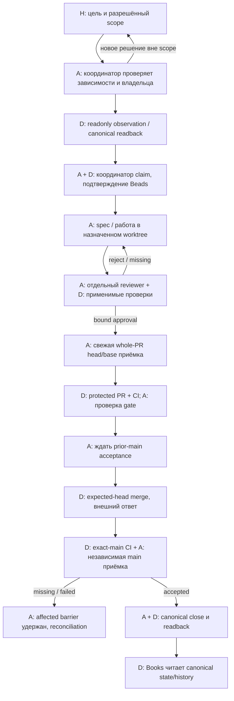
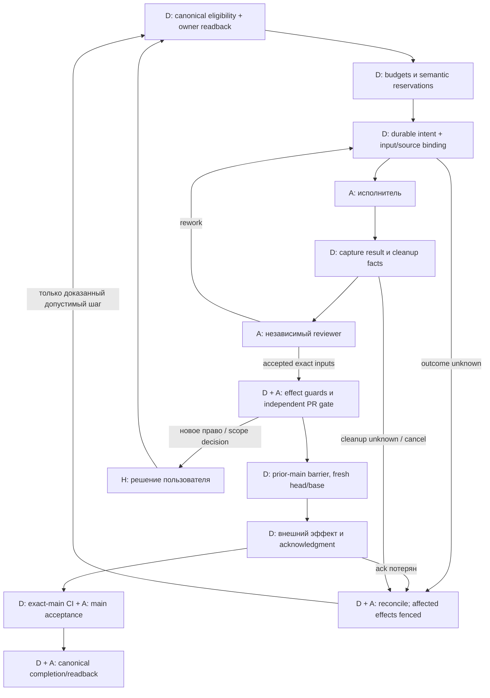

# Граф управления: право на переход важнее формы графа

Дата: 2026-11-06. Задача **tt-e4n.4**, историческая ссылка [Issue54](https://github.com/Sibiya666/task-tower/issues/54). Это исследование исходников и сохранённых свидетельств, **не реализация controller**. Все семь предлагаемых проверок ниже — **NOT RUN**; upstream/product/native tests и model experiments не выполнялись.

Для Task Tower полезен явный граф решений, но из него не следует необходимость нового graph framework. Сейчас Beads хранит задачи, зависимости и историю; Books читает их; CI проверяет выбранный маршрут; координатор в активном чате организует работу и содержательную приёмку. Между этими частями ещё нельзя ставить знак «поставленная автономная система». Рекомендуется **adapt** таблицу переходов и владельцев, сохранить действующие gates и **defer** выбор нового движка до доказательства нужных гарантий. Worktree разделяет исходники, а не credentials, процессы или полномочия.

## 1. На какие свидетельства опирается граф

Исходники Task Tower прочитаны в назначенном отдельном worktree на **e021e0c8c38f1ea9af6bf1860d2eedcff97edca1**, ветка `docs/control-ownership-research`. Это локально проверенные HEAD/branch, не новый remote-main audit. Начальный Git status вернул пустой stdout и exit0, но предупредил о недоступности пользовательского ignore-файла; его не читали и не исправляли. Принятие этой базы подтверждено переданным exact-main receipt PR89. Курс закреплён на **6420da2d57c901c401fc909354a7f5f7fce81882**, README blob **8bc0e5dc0c3f559369a15484e7c976fe1bd65e59**. Старые даты источников в [handoff](02-handoff-and-recovery.md) и [acceptance audit](03-acceptance-gates-audit.md) не обновляются задним числом.

| Класс / источник | Проверенный факт | Предел вывода |
| --- | --- | --- |
| Курс: [Loop M13][course-loop], [Graph M14][course-graph] | Цель, проверка и остановка; типы узлов, общее состояние, маршруты возврата, отдельный reviewer и checkpoints | Учебный дизайн, не испытание Task Tower и не доказательство безопасности retry |
| Shipped [admission][admission], [Books][books], [harness adapter][harness] | Admission выдаёт `eligible_observation` после readonly ready/show и сверки source; Books читает list/events и отмечает partial/unavailable. Адаптер объявляет interactive launch, но не resume/independent_review/autonomous_merge | Наблюдение не claim/launch, closed не acceptance. Capability flags относятся к этому адаптеру, не ко всем возможностям Codex |
| Shipped [PR CI][pr-ci], [postmerge CI][post-ci], [typed docs][docs-ci] | Aggregate отказывает при неполном выбранном маршруте; postmerge привязан к merged PR в main и его merge SHA | CI не принимает содержание и не закрывает Beads. Docs artifact сохраняет `runtime_tests:not_run` |
| Действующие [правила][rules], [unified spec][unified] | Независимый whole-diff verdict на exact head/base, актуальный CI, expected-head merge и exact-main barrier; task-dependent agent count | Авторизация и текущая координация не равны поставленному persistent pool |
| Архив: [pipeline journal][journal-claim], [create intents][create], [postmerge journal][post-journal] | Есть реальные локальные owner/CAS/intent/recovery predicates | Они не становятся Beads controller, distributed fencing или runtime PASS от наличия в дереве |
| Сохранённые coordinator receipts PR87/88/89 и защиты main | Реальные документационные циклы и прочитанная конфигурация GitHub | Ни fault-injection trials, ни доказательство unattended execution; APIs здесь заново не запрашивались |

В PR87 main **78e8d1b…** принят отдельным `trust_main_acceptor`; PR88 main **9d17ef7c…** — `ordinary_pilot_main_acceptor`; PR89 main **e021e0c8…** — `acceptance_main_acceptor`. Их postmerge runs соответственно [42102319627][ci87], [42105040646][ci88], [42107067186][ci89]; receipts подтверждают typed документационную проверку, не runtime qualification. PR88 — разрешённый однозадачный ordinary-session pilot, а не общий отказ от G1/G2. [PR87][pr87], [PR88][pr88], [PR89][pr89].

Для PR89 отдельно прочитаны сохранённые raw after/history-after: `tt-e4n.3` closed, прежний assignee `task-tower-acceptance-research-coordinator`, closure event `11012909-86f1-53a4-8f3d-2311651dc118` от 2026-11-05T20:53:02Z; семь прежних event IDs присутствуют среди восьми итоговых. Это проверка предоставленного readback, не наше новое закрытие и не доказательство общей идемпотентности. Публичные связи: [PR89 receipt][pr89-receipt], [Issue53 receipt][issue53-receipt].

Прочитанный main-protection result фиксирует PR requirement, strict checks `scope`, `unittest (windows-latest)` от Actions app15368 и `task-tower/pr-acceptance` без app binding, enforce admins, запрет force/delete и разрешение conversations. Human approving count равен0. Это состояние после отдельного разрешения пользователя, а не отрицательный production-тест. Сервер не проверяет содержательную независимость reviewer или exact-base смысл статуса; эти обязанности остаются у координатора. [Acceptance audit](03-acceptance-gates-audit.md), [правила][rules].

## 2. Что переносить из Loop/Graph, а что нет

Полезная часть курса — сделать видимыми владельца цели, условие остановки, независимую проверку и путь возврата. В его примере `review == pass` ведёт к узлу merge, а checkpoint обещает продолжение после падения. Для нас одного булева verdict и файла состояния недостаточно: нужны source-bound evidence, current owner, исход remote effect и prior-main barrier. Возврат после reject означает новую исправленную версию и новые проверки, а не удаление истории или автоматический откат чужих изменений. [Пример графа][course-graph], [handoff](02-handoff-and-recovery.md).

Курс рекомендует WIP=1 и связывает его с очередями; это не основание навязать один слот всей Task Tower. Его численные/универсальные утверждения о контексте и производительности здесь не подтверждены измерениями. Текущая пользовательская авторизация допускает **до двух независимых разрешённых задач**, с отдельным source ownership, зависимостями и бюджетами. Она не требует два постоянно работающих процесса и не разрешает два конфликтующих эффекта. [T7 курса][course-wip]; действующая workspace-авторизация и [unified §5.1][unified].

Новый framework сам по себе не даёт честного reviewer, атомарного remote effect или безопасной смены owner. Поэтому рисунок должен описывать проверяемые переходы даже при простом controller; перенос численного «минимум три критерия — берите граф» как обязательного правила не нужен. Ни throughput gain, ни fairness новой реализации этим исследованием не измерены.

## 3. Фактический граф текущего процесса

**A** — агентное решение/работа; **D** — детерминированная операция; **H** — решение человека. Квадрат A-координатора означает активный чат, не фоновый daemon. Сплошные рёбра ниже — действующий процесс/контракты, подтверждённые указанными источниками и отдельными docs deliveries; это не утверждение, что каждое отрицательное ребро автоматически enforced.

Claim здесь выполняет авторизованный координатор через Beads, **не** `beads_admission.observe`. Books может обновляться на любом этапе, а не только после close; последнее ребро показывает проекцию результата, не новую launch/acceptance authority. Визуальное подтверждение C в открытой книге этим исследованием не заявлено.

| state | event | precondition | owner | transition | evidence / отказ |
| --- | --- | --- | --- | --- | --- |
| Разрешённый backlog | Задача выбрана | Свежие зависимости, scope, отсутствие конфликтующего owner | Координатор; Beads хранит authority | Наблюдение готовности | [Admission][admission]; snapshot не token владения |
| Ready observation | Claim/readback | Atomic canonical claim в разрешённом контексте, owner подтверждён | Координатор / Beads | Claimed, можно назначить работу | Claim receipt; конфликт/unknown запрещает effects, не разрешает takeover |
| Claimed | Spec/plan accepted | Отдельный acceptor, назначенный source, актуальные входы | Автор + независимый reviewer | Подготовка исполнения | Spec/plan/actual source; [unified][unified] |
| Работа | Результат и проверки получены | Связь task/source/attempt где реально известна; ошибки/cleanup не скрыты | Исполнитель | **execution completed**, ещё не accepted | Diff, command/CI receipts, limits; prose «готово» недостаточно |
| Completed | Независимый verdict | Whole diff, критерии, подлинные outputs, findings, отдельный автор/reviewer | Приёмщик | Accepted либо rework | [02](02-handoff-and-recovery.md)/[03](03-acceptance-gates-audit.md); changed inputs инвалидируют verdict |
| Accepted source | PR готов к merge | Exact current head/base, required CI/status, no blockers, mergeability | PR acceptor и координатор | Merge eligible | [Правила][rules]; required status не доказывает его смысл |
| Merge eligible | Внешняя merge operation | Предыдущий exact main принят, expected head, свежая пара | Координатор; GitHub effect | **Persisted intent** → observed result либо unknown | Intent и ответ/readback раздельны; нет доказанного общего Beads effect parser |
| Merged | Postmerge CI/review | Точный M, соответствующий тип artifact, независимый main verdict | CI + main acceptor | Exact-main accepted | [Postmerge][post-ci]; failed/missing удерживает следующий merge |
| Main accepted | Canonical completion | Все evidence и исход closure известны | Координатор / Beads | **accepted/done** и history readback | PR89 readback; отсутствие ответа требует reconcile, не повторного close |
| Любой effect | Cancel/timeout/crash | Доказанное право и известный outcome/cleanup для продолжения | Координатор | Affected stop/unknown/reconcile | [Handoff](02-handoff-and-recovery.md); запрос cancel не rollback |

Слова state в таблице — аналитические состояния процесса, не новые значения схемы Beads. В текущей координации intent может быть отдельным immutable receipt; shipped admission/Books его не исполняют. Accepted, canonical closed и проверенное отображение — разные наблюдения.

## 4. Владельцы, ресурсы и границы параллельности

| Объект | Кто вправе писать | Как обнаруживать конфликт / что пока неизвестно |
| --- | --- | --- |
| Каноническая задача, зависимости, owner/history | Авторизованный координатор через Beads | Fresh authoritative readback; локальный packet не новая authority. Revision сравнивать как opaque identity, не как растущий counter |
| Source и семантический компонент | Назначенный автор в собственной ветке/worktree | Учитывать интерфейс/инвариант, не только пересечение файлов. Shared navigation у координатора; coupled behavior сериализуется |
| Evidence и verdict | Источник результата; отдельный acceptor для решения | Артефакты с digest/actor/source, неизменяемая история. Право автора редактировать source не даёт право принять его |
| Попытка и временный ресурс | Исполнитель в рамках действующего claim/бюджета | Claim, lease, runner/session, fence и stopped receipt различны. Сквозной live fence нового пути не показан |
| Merge/main | Координатор + GitHub; independent main acceptor | Один merge barrier на репозиторий. Остальная разрешённая работа возможна при свободных ресурсах/ownership |
| Пользовательское решение | Пользователь | Новые права/существенное изменение scope; не дополнительное routine одобрение каждого уже разрешённого PR |

**Три разных лимита.** WIP исполнителя ограничивает одновременный контекст/изменения. Пул координатора ограничивает число независимых задач, reviewers и доступные CPU/time/cost ресурсы. Main barrier ограничивает интеграцию в один репозиторий. Нельзя выводить любой из них из другого: pending postmerge не запрещает читать исходники другой задачи; неизвестный живой worker не позволяет объявить его ресурс свободным.

Архивный `PipelineJournal.claim(max_active)` принимает1..2, считает unknown среди active, проверяет component keys и выполняет условный update owner/state/generation/input. Но `_repository_busy` дополнительно сериализует действия внутри репозитория даже для разных компонентов. Поэтому «max_active=2» в этом коде не доказывает два одновременных активных worker одного repo и не является действующей политикой Beads. `claim_controller` проверяет локального owner/PID, а не распределённый lease между машинами. [Claim/ownership][journal-claim], [controller/recovery][journal-recover].

Архивные тесты действительно содержат assertions про чужой owner, unknown capacity, удержание слота после смерти worker и единственного победителя двух local journal claims. Они **прочитаны, не запущены**; это не испытание текущих canonical claims. [Pipeline tests][journal-tests], [postmerge tests][post-tests].

**Fairness — отдельное требование.** Архивный delivery cursor циклически выбирает до8 unknown lookup rows; submit имеет отдельный предел8. Это распределяет попытки lookup, но не доказывает справедливость запуска задач. Pipeline priority sorting без измерения aging также не доказывает отсутствие starvation. [Lookup][lookup], [dispatcher][dispatcher]. Для будущего простого controller разумно предложить: сначала eligible/authorized задачи, затем явный priority и порядок ожидания; ограниченная порция работы и возврат планировщику; запись причины отсрочки; измерение wait time/starvation отдельно. Числа квантов/aging требуют отдельного дизайна и данных. Blocked задача не держит свободный слот автоматически, но неизвестные процессы/effects сохраняют свои reservations до reconciliation. Нельзя ради fairness обойти зависимость, semantic lock или main gate.

## 5. Семь контрпримеров: безопасная проверка решения, не сбой production

Для всех строк исходный **F0** — минимальный синтетический текстовый пакет: task/owner snapshot, два actor ID, источник H/B, границы компонента, разрешённые ресурсы, intent/outcome и известные CI/main receipts. Это вымышленные fixtures без private DB/logs/tokens, явно помеченные synthetic. В каждой независимой копии меняется только указанное поле/событие. Рецензент применяет опубликованную таблицу переходов, записывает разрешённый next action, запрет и конкретное evidence, которое снимет unknown. Это повторяемая **ручная decision procedure**, не существующая CLI-команда. Все проверки **NOT RUN**.

| Случай и порядок событий | Наивное небезопасное правило | Ожидаемое решение / безопасная мутация / предел evidence |
| --- | --- | --- |
| **F1: два worker одной Issue/Bead.** A и B прочли ready; A получил claim; B продолжает по старому snapshot | Ready означает право запускать обоих; session UUID заменяет owner | В копии F0 добавить второй stale ready actor при canonical owner A. B не получает effects; нужен свежий canonical claim/readback. [Admission][admission] не делает claim. Архивный CAS — пример guard, не новый Beads backend |
| **F2: crash после эффекта.** Intent merge/push/create сохранён; remote effect мог завершиться; ack потерян | Возобновить checkpoint и повторить operation | Удалить ack при сохранённом target/expected identity. Сначала remote readback: совпавший result привязать к intent; конфликт остановить; unavailable оставить unknown. Merged требует ещё main CI/verdict. [Create journal][create] сохраняет reservation, но не remote exactly-once |
| **F3: потеря сети.** Cached ready/green есть; current ownership/remote outcome недоступны | Воспользоваться кешем как текущим разрешением | Заменить current readback на unavailable. Effects затронутого шага удержаны; допустим source-only анализ другой owned задачи в бюджете. Books partial/unavailable не success. [Books][books] |
| **F4: конфликт компонентов.** A меняет producer JSON, B в другом файле меняет consumer assumptions | Разные файлы/worktrees означают независимость | В F0 добавить общий schema/invariant к двум file-disjoint задачам. Координатор назначает одного владельца интерфейса и последовательную интеграцию/совместимый контракт; второй зависимый effect ждёт. Архивные component keys полезны, но их полнота семантически не доказана. [Claim][journal-claim] |
| **F5: prior-main ждёт.** M1 merged, exact-main CI/verdict отсутствует; P2 имеет green premerge | Зелёный P2 разрешает следующий merge | Удалить main verdict M1, отдельно повторить fixture с failed CI M1. Merge P2 запрещён; другая работа может идти. После изменения base прежнее H/B принятие P2 устарело. [Правила][rules], [acceptance cases](03-acceptance-gates-audit.md) |
| **F6: lease истёк, старый worker вернулся.** A не подтвердил stop; новый packet называет B | Часы или новый UUID дают B право, поздний результат A всё ещё подходит | Заменить owner observation при старом attempt/result. Без подтверждённой передачи и effect-bound fence нельзя запускать конфликтующие effects или принимать stale result. Local publication lease допускает переclaim по времени, но owner check журнала не доказывает прекращение remote записи A. [Postmerge journal][post-journal] |
| **F7: cancel и descendants.** Parent ответил/завершился; cleanup child неизвестен | Cancel requested или exit0 означает cancelled safely/done | Заменить cleanup=true на unknown при имеющемся результате. Не принять completion, не освобождать конфликтующий ресурс; нужен исход процесса/descendants и reconciliation effects. Архивный `finish_attempt` переводит неподтверждённый cleanup в unknown, `cancel` не равен rollback. [Attempts][attempts], [cancel/recovery][journal-recover] |

Общий критерий будущей decision evaluation: ни одна строка не разрешает дублирующий effect, смену owner из prose, stale acceptance или освобождение непроверенного ресурса; каждое unknown имеет конкретный источник проверки. Отказ reviewer по fixtures подтвердил бы качество решения на этих входах, но не автоматическое enforcement. Реальная fault проверка будущего controller потребует отдельного разрешённого окружения, фактических effect-bound guards и независимой приёмки.

## 6. Целевой граф — предложение, а не уже поставленная система

Цель предложения — сделать каждый эффект зависимым от проверяемых authority и evidence. Durable intent и decision checkpoint дополняют Beads историю, а не создают вторую очередь; формат и host storage ещё не реализованы. Fencing означает проверку действующего token/поколения **на границе записи**, где это поддерживается; наличие поля в packet недостаточно. Где внешний API не предоставляет такой проверки, необходимы сериализация, identity-bound операция и reconciliation с явными пределами, а не обещание exactly-once.

Это желаемая структура. Fresh owner/source checks, reservations, процессный cleanup и remote acknowledgment не становятся одной атомарной транзакцией от рисунка. Между ними нужны явно проверяемые контракты; пути «Q → A» не означают replay. Возврат к A заново проверяет, что можно делать, и может оставить effect заблокированным. Human узел не обход gate и не обязательное повторное согласование routine PR.

| Вариант | Плюс | Цена/риск и проверка, которой ещё нет | Решение |
| --- | --- | --- | --- |
| Текущая координация + явная таблица | Уже есть реальные docs deliveries и independent gates; не требует нового runtime | Зависит от сохранения контекста/внимания координатора; нет подтверждённого unattended recovery/fairness | **Keep/adapt** как честно обозначенный текущий процесс |
| Простой explicit controller поверх Beads | Можно ограничить переходы, owners, intents и effect adapters без смены task authority | Потребует реальной реализации/испытания cancellation, fencing, unknown effects, review и main barrier; сложность не исчезает | **Предпочтительный baseline для будущего сравнения**, не разрешение внедрять сейчас |
| Graph framework поверх тех же контрактов | Может быть полезен при сложных маршрутах/параллельных ветвях и существующих адаптерах | Дополнительные state/retry/checkpoint semantics и поверхность отказа; риск второй authority и автоматического replay. Конкретный продукт здесь не квалифицирован | **Defer**, пока не показано преимущество над простым controller при одинаковых guarantees/бюджетах |

При будущем сравнении фиксировать одинаковые переходы/guards и случаи F1–F7, затем смотреть корректность восстановления, время решения, число внешних повторов, wait time и стоимость сопровождения. Дешёвый рисунок или меньше строк кода не компенсируют неизвестный duplicate effect. Это проект измерения; сейчас нет чисел или обещания выигрыша.

## 7. Куда относятся выводы

| Связь | Что передаёт исследование | Чего оно не завершает |
| --- | --- | --- |
| Архивные [Issue16][issue16] / [Issue18][issue18] | Прочитанные controller/journal/group идеи и ограничения локальных reservations | Не действующие зависимости; conveyor не возобновляется |
| `tt-m9l` / [Issue19][issue19] | Граница local PID/lease и будущего межмашинного fencing | Никаких multi-machine запусков или adoption ownership |
| `tt-auq.4` / [Issue25][issue25] | Разделение budget/health/cancel/cleanup, F1/F3/F4/F6/F7 и fairness questions | Не реализация пула и не доказанное recovery |
| `tt-auq.5` / [Issue26][issue26] | F2/F5, remote reconciliation и сериализованный exact-main barrier | Не автоматический main worker или canonical auto-close |
| PR87/88/89; [PR85][pr85] | Датированные позитивные docs cycles; узкий обычный пилот; независимые gates | PR85 остаётся непринятым HOLD-кандидатом; B/G1/G2/C и эпики не закрываются |

Crosswalk опирается на canonical критерии этой задачи, [backlog][backlog] и принятые02/03; статусы соседних задач здесь не перепроверялись живым запросом. Не следует повторно объявлять уже принятые узкие исследования незавершёнными из-за отсутствия будущего runtime.

Покрытие четырёх критериев: state/event/precondition/owner/transition/evidence и actual/target — §3/6; параллельность и ownership — §4; пять обязательных и два дополнительных контрпримера — §5; архив/актуальные задачи/PR и сравнение движков — §7/6. Source predicates и сохранённые receipts дают высокую уверенность в описанных границах; эффективность предложений и поведение нового controller при реальном сбое остаются **unknown**. Этот текст требует отдельной whole-content и PR/main приёмки; автор не принимает собственный результат.

[course-loop]: https://github.com/justxor/Harness_ru/blob/6420da2d57c901c401fc909354a7f5f7fce81882/README.md#L1764-L1895
[course-graph]: https://github.com/justxor/Harness_ru/blob/6420da2d57c901c401fc909354a7f5f7fce81882/README.md#L1945-L2107
[course-wip]: https://github.com/justxor/Harness_ru/blob/6420da2d57c901c401fc909354a7f5f7fce81882/README.md#L595-L620
[admission]: https://github.com/Sibiya666/task-tower/blob/e021e0c8c38f1ea9af6bf1860d2eedcff97edca1/task_tower/beads_admission.py#L225-L344
[books]: https://github.com/Sibiya666/task-tower/blob/e021e0c8c38f1ea9af6bf1860d2eedcff97edca1/task_tower/beads_books.py#L95-L147
[harness]: https://github.com/Sibiya666/task-tower/blob/e021e0c8c38f1ea9af6bf1860d2eedcff97edca1/task_tower/harness.py#L12-L14
[pr-ci]: https://github.com/Sibiya666/task-tower/blob/e021e0c8c38f1ea9af6bf1860d2eedcff97edca1/.github/workflows/cli.yml#L66-L103
[post-ci]: https://github.com/Sibiya666/task-tower/blob/e021e0c8c38f1ea9af6bf1860d2eedcff97edca1/.github/workflows/postmerge.yml#L1-L144
[docs-ci]: https://github.com/Sibiya666/task-tower/blob/e021e0c8c38f1ea9af6bf1860d2eedcff97edca1/task_tower/ci_docs.py#L343-L364
[rules]: https://github.com/Sibiya666/task-tower/blob/e021e0c8c38f1ea9af6bf1860d2eedcff97edca1/AGENTS.md
[unified]: ../../superpowers/specs/2026-11-05-task-tower-unified-design.md
[journal-claim]: https://github.com/Sibiya666/task-tower/blob/e021e0c8c38f1ea9af6bf1860d2eedcff97edca1/task_tower/pipeline_journal.py#L427-L512
[attempts]: https://github.com/Sibiya666/task-tower/blob/e021e0c8c38f1ea9af6bf1860d2eedcff97edca1/task_tower/pipeline_journal.py#L605-L644
[journal-recover]: https://github.com/Sibiya666/task-tower/blob/e021e0c8c38f1ea9af6bf1860d2eedcff97edca1/task_tower/pipeline_journal.py#L876-L950
[create]: https://github.com/Sibiya666/task-tower/blob/e021e0c8c38f1ea9af6bf1860d2eedcff97edca1/task_tower/creation_journal.py#L13-L78
[post-journal]: https://github.com/Sibiya666/task-tower/blob/e021e0c8c38f1ea9af6bf1860d2eedcff97edca1/task_tower/postmerge_journal.py#L100-L168
[journal-tests]: https://github.com/Sibiya666/task-tower/blob/e021e0c8c38f1ea9af6bf1860d2eedcff97edca1/tests/test_pipeline_journal.py#L39-L143
[post-tests]: https://github.com/Sibiya666/task-tower/blob/e021e0c8c38f1ea9af6bf1860d2eedcff97edca1/tests/test_postmerge_journal.py#L20-L106
[lookup]: https://github.com/Sibiya666/task-tower/blob/e021e0c8c38f1ea9af6bf1860d2eedcff97edca1/task_tower/dispatch_delivery.py#L156-L168
[dispatcher]: https://github.com/Sibiya666/task-tower/blob/e021e0c8c38f1ea9af6bf1860d2eedcff97edca1/task_tower/dispatcher.py#L47-L134
[ci87]: https://github.com/Sibiya666/task-tower/actions/runs/42102319627
[ci88]: https://github.com/Sibiya666/task-tower/actions/runs/42105040646
[ci89]: https://github.com/Sibiya666/task-tower/actions/runs/42107067186
[pr87]: https://github.com/Sibiya666/task-tower/pull/87
[pr88]: https://github.com/Sibiya666/task-tower/pull/88
[pr89]: https://github.com/Sibiya666/task-tower/pull/89
[pr89-receipt]: https://github.com/Sibiya666/task-tower/pull/89#issuecomment-6669148125
[issue53-receipt]: https://github.com/Sibiya666/task-tower/issues/53#issuecomment-6669161813
[issue16]: https://github.com/Sibiya666/task-tower/issues/16
[issue18]: https://github.com/Sibiya666/task-tower/issues/18
[issue19]: https://github.com/Sibiya666/task-tower/issues/19
[issue25]: https://github.com/Sibiya666/task-tower/issues/25
[issue26]: https://github.com/Sibiya666/task-tower/issues/26
[pr85]: https://github.com/Sibiya666/task-tower/pull/85
[backlog]: ../../backlog.md