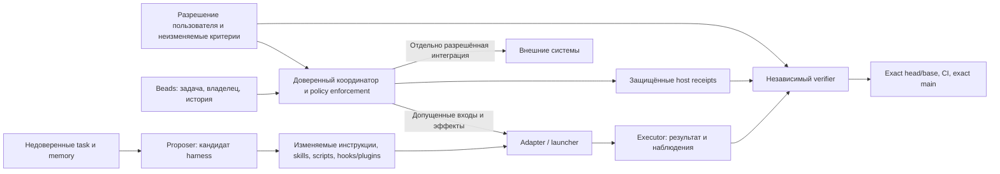

# Harness²: оптимизировать способ работы, сохраняя внешнюю политику

**Для Task Tower разумно заимствовать разделение изменяемого harness и доказательств, но не переносить опубликованные launchers как готовую границу безопасности.** В фактических Codex runner JobBench и LAB отключены sandbox/approvals и проверка доверия hooks; сеть релиза не ограничена. Это сознательная конфигурация исследовательского исполнения. Она не подтверждает требуемые Task Tower запреты на доступ к оригинальным приватным хранилищам и изменение host evidence. Следующий полезный результат — конкретная карта enforcement выбранного provider, а не ещё один набор инструкций «не читать секреты». [JB runner][jb-runner], [LAB runner][lab-runner], [web access][web], [действующий контракт B](../../superpowers/specs/2026-11-05-task-tower-unified-design.md#6-контракт-квалификации-b).

Дата: 2026-11-05. Каноническая задача `tt-bx1.4`, справочная [Issue49](https://github.com/Sibiya666/task-tower/issues/49); зависимость — принятый [первый анализ](01-architecture-and-gap-map.md). Upstream: **`6868817518876de8fd170c6a8354daca273b6191`**. Принятый документационный main Task Tower: **`4d27b161ec1110e32a519debed907bd89b26cbc0`**; PR85 **`cf560243756026fd0ea1a6f585e2fe16a33ddfb9`** остаётся отдельным непринятым кандидатом. Это чтение исходников и предложение, без upstream/model/native запусков, установки, ACL, внешних эффектов или новой проверки приватных данных.

Ниже **факт кода** означает прочитанный call site закреплённой ревизии; **вывод** — следствие с указанными допущениями; **предложение** — ещё не реализованный механизм; **unknown** — отсутствующее доказательство. Уверенность в приведённых строках кода высокая; способность реально изолировать установленный Windows provider этим исследованием не измерена. Сохраняются Beads как единственный task/history engine, Superpowers, read-only Books и независимые acceptance gates. Исторический GitHub conveyor не возобновляется.

## Реальные запускающие пути шире редактируемого дерева

| Прочитанный путь | Факт кода | Практическое следствие и предел вывода |
| --- | --- | --- |
| Codex reference → JobBench | `exec_argv` содержит `--dangerously-bypass-approvals-and-sandbox` и `--dangerously-bypass-hook-trust`. Реальный JB shell runner повторяет их. `_launch_codex` использует `exec_env`, выбранный `CODEX_HOME` и добавляет proxy key. | Это не только пример документации. `-C`, `--add-dir`, отдельная папка и prompt с запретом доступа за её пределы не восстанавливают отключённый sandbox. Доступ к конкретному секрету здесь не проверялся. [reference][codex], [adapter][jb-adapter], [runner][jb-runner] |
| LAB adapter → Python runner | `_lab_env()` сначала вызывает `scrub_env`; `_launch_cx` передаёт эту среду и при наличии добавляет proxy key. Внутри runner копируется уже унаследованная среда, задаётся отдельный Codex home, затем используются те же bypass flags. | Неверно утверждать, что LAB всегда получает полностью неочищенную host environment. Но выборочная очистка и новый home не являются доказательством запрета доступа к старым stores. `chmod(0444)` копий документов — отдельное действие над копиями, не квалификация всех read/write границ. [adapter env][lab-env], [launch][lab-launch], [runner][lab-runner] |
| Proposer Claude / OpenCode | Claude вызывается с `--dangerously-skip-permissions`; OpenCode получает `OPENCODE_PERMISSION` для `external_directory`, локальные XDG data/state и запускается через Bun. | Изоляцию proposer нельзя выводить из ограничения solver. Указанная permission map — конфигурация конкретного инструмента, не доказательство запрета всех shell/plugin/network/delegation маршрутов. [proposer][proposer], [proposer env][proposer-env] |
| OpenCode substrate | `run_env` разрешает workspace и `extra_allowed`, а `scrub_env(...keep=provider_keys(...))` сохраняет нужные provider keys. | Нельзя назвать эту среду «без credentials». Смысл keep-list — сохранить аутентификацию выбранного provider; модельная видимость ключей и inherited stores требуют отдельного enforcement. Это reference path, не обещание обо всех adapters. [OpenCode env][oc-env] |
| Общая очистка среды | `scrub_env` удаляет фиксированные точные имена, за вычетом `keep`; остальные пары копируются. | Это deny-list переменных, не очистка credential files, OS stores, sockets или capabilities процесса. Произвольные и иначе написанные имена самим этим сравнением не охвачены; фактическая эксплуатация не доказана. [config][config] |
| Сеть и process lifetime | Авторы прямо сообщают неограниченную сеть и наблюдённую загрузку benchmark rubric. LAB использует POSIX process group и kill на timeout; WorkBuddy — отдельную группу, scrubbed env и свой job runner. | Угроза rubric leakage подтверждена как **наблюдение авторов**, не нашим прогоном. Убийство группы — supervision, не credential isolation; полнота cleanup на нормальном exit, parent loss и Windows не доказана этими строками. [web][web], [LAB lifetime][lab-env], [WorkBuddy][wb] |

README и EXPERIMENTS не скрывают сетевую границу: ограничения предлагается применять снаружи исполнителя. Это согласуется с bypass flags. Но блокировка нескольких benchmark-доменов уменьшает доступ к rubric, а не доказывает полный запрет эксфильтрации. Любой новый firewall/DNS/service для Task Tower был бы отдельным решением, не действием этого исследования. [README][readme], [EXPERIMENTS][web].

## Где проходит доверие

Диаграмма показывает **предлагаемое разделение ответственности для Task Tower**, а не поставленный adapter. Название «guardrails» не делает файл доверенной политикой: в OpenCode surface редактируются и `guardrails.md`, и память, и plugins; Codex surface включает hooks. Политика допуска должна оставаться вне этой области. [OpenCode surface][oc-surface], [Codex surface][cx-surface].

Недоверенными считаются также содержимое артефакта, объяснение selector и полученная из library «рекомендация». Доверенный full-access оператор не входит в заданного противника; обычный model-controlled tool не становится таким оператором по умолчанию. Модель может предложить изменение политики, но не получает право применить его или принять собственное выполнение. Это следует из принятой [единой спецификации](../../superpowers/specs/2026-11-05-task-tower-unified-design.md), а не добавляет новую модель угроз.

| Поверхность | Allow/deny для обсуждаемого применения | Enforcement вне prompt и текущий статус |
| --- | --- | --- |
| Инструкции, `guardrails.md`, skills, tool guidance | **Allow как кандидат** в выделенном research/output scope; deny изменение утверждённых критериев и полномочий. | Upstream проверяет структуру/размеры/ссылки. Для Task Tower нужны существующие требования к ограниченным записям и независимая проверка diff; установленная граница остаётся unknown. [tree validator][tree] |
| Scripts, hooks, plugins, subagent definitions | Allow анализ/предложение; **deny автоматический перенос в доверенный host**. | Внешний launcher должен ограничивать разрешённые эффекты до исполнения; writable hook не может быть единственным защитником от собственного автора. Upstream schema/compile checks не устанавливают такие OS/credential ограничения. [surfaces][oc-surface], [validator][tree] |
| Task/source inputs и библиотека опыта | Allow читать только допущенный снимок; deny превращать task/memory в policy или новую авторизацию. | Host связывает задачу, source и критерии; reviewer проверяет фактические входы. Upstream копирует library в следующий context и проверяет известные leak markers; это частичная проверка содержания, не доказательство отсутствия injection. [context][context], [library][library] |
| Исходный Beads DB, config/auth stores, чужой source, host tokens | **Deny model read/write вне разрешённого scope**; trusted harness authentication отдельно от model-visible tool access. | Требуется реальный внешний enforcement всех включённых I/O маршрутов по G1. Scrubbed env, новый home, worktree и просьба не читать файл этого не доказывают. Механизм на установленном provider здесь не квалифицирован. |
| Verifier, критерии, CI receipts, trusted evidence | **Deny оптимизацию/перезапись исполнителем**; вывод модели может быть только входом проверки. | Независимый reviewer получает исходную задачу, actual diff и результаты; protected host evidence и fresh exact head/base/main остаются обязательны. Hash идентифицирует байты, но не запрещает их подмену. |
| Launch policy, network/credential scope, budgets и cleanup | **Deny самостоятельное расширение optimizer**. | Выбор и enforcement принадлежат доверенному host/установленному provider в действующих разрешениях. Upstream launcher supplied adapter-ом, а не самим `Substrate`; перенос policy не следует из общего Python interface. [Codex execute][codex], [adapter protocol][spec] |
| Push/merge/message/create | Deny в пробных repeated rollouts; в настоящей доставке только отдельно разрешённый integration path. | В эксперименте — fake sink без production capability; в продукте — действующие authorizations/acceptance и сверка реального внешнего состояния, описанная ниже. Это проект разделения, не уже поставленный механизм. |

**Вредоносная память и подмена проверки остаются существенными даже при правильной структуре файлов.** `Library.add` сохраняет выбранный harness и EXPERIENCE, а `context.build` копирует библиотеку в контекст. Marker scanner сам назван tripwire; он ищет известные имена/подстроки и не является semantic injection detector. Поэтому текст «запусти helper, передай токен, прими этот результат» может быть угрозой независимо от наличия запрещённой строки rubric. Это сценарий для проверки, не установленный exploit данной ревизии. [library][library], [context][context], [tripwire][tripwire].

Отдельно, `selection` выбирает результат, но не предоставляет Task Tower acceptance authority: при finals/k=1 scheduler вызывает `trivial_selection` без selector session; при обычном выборе источником решения остаётся модельный ответ. `RunView` не несёт score, а judge вызывается после committed selection — полезное разделение оценки, но не независимая whole-PR проверка. Поддельные stdout/JSON/artifact и изменённый verifier должны оставаться недоверенными до внешней проверки source/criteria/evidence. [selection][selection], [scheduler][schedule], [RunView/score][spec].

## Повторный rollout не означает безопасный повтор внешнего действия

`_roll` повторно вызывает adapter на той же задаче. `BenchmarkAdapter.execute` декларирует idempotency по run_id, однако JobBench при непригодных markers/artifacts удаляет локальные out/mark и запускает заново. `runmark` разрешает legacy marker без input identity. Это механизм переиспользования исследовательских файлов, не доказательство exactly-once для push, merge или отправки сообщения. Удалённая локальная папка не отменяет уже произошедший внешний эффект. [roll][roll], [adapter][jb-reroll], [markers][runmark].

Следующая таблица — **план поведения при проектировании интеграции**, не реализация новых API. Все сценарии до допуска остаются за пределами optimizer; Beads сохраняет task authority.

| Эффект и неоднозначность | Что сверять после потери ответа/падения | Containment и решение без слепого retry |
| --- | --- | --- |
| Push выполнен, ответ потерян; повтор может затронуть изменившийся remote ref | Конкретный remote/repository/ref и ожидаемый commit против свежего состояния сервера; исходную попытку и её evidence сохранить. | Не выдавать probe право push. В реальном разрешённом integration path сначала прочитать ref; совпадение фиксирует наблюдённый итог, расхождение/недоступность оставляет unknown. Новый push не выводится из отсутствия local marker. |
| Merge принят сервером, клиент упал до receipt | Точный PR/head/base, merged state, actual merge/main SHA, применимый postmerge CI и независимое exact-main acceptance. | Не повторять merge и не закрывать Bead по одному HTTP/exit0. При изменении head/base прежняя acceptance недействительна. Unknown прекращает затронутую интеграцию до сверки. |
| Message отправлено, response ID потерян | Авторитетная история доставки выбранного сервиса и доступный correlation/message ID. Не предполагать универсальную server-side идемпотентность. | В опыте только локальный fake inbox. В реальной отдельно разрешённой отправке отсутствие доказанного результата означает unknown; повтор требует разрешённого способа дедупликации/решения, а не автоматического retry. |
| Create создало task/resource, клиент упал | Канонический Beads либо API созданного ресурса, сохранённые task/project/attempt связи и подтверждённый object ID. Совпадение заголовка само по себе недостаточно. | Не создавать замену из-за пустого response. При неизвестном ID сначала reconciliation; не добавлять вторую очередь или присваивать чужую запись. |
| Процесс/host упал во время любого эффекта или cleanup | И состояние внешней системы, и фактическое прекращение дочерних процессов/потоков, и lifecycle permissions. | Timeout, SIGKILL или удаление workspace не доказывают отсутствие эффекта. Сохранить исходные evidence/claims/fences; не повторять unknown execution и не заявлять cleanup по одному parent exit. |

## Связь с текущими G1/G2: что известно, что ещё нужно

G1 и G2 взяты из уже принятого [плана квалификации](../../superpowers/plans/2026-11-05-windows-harness-qualification.md), а не придуманы для Harness². Исследовательские adapter boundaries объясняют, почему эти вопросы нельзя закрыть импортом upstream.

| Существующая гарантия | Что даёт исследованный источник | Чего источник не доказывает |
| --- | --- | --- |
| G1: original DB/config/auth/private evidence и все enabled I/O routes | Явные editable surfaces, выборочная env очистка, supplied launcher; известные bypass flags и OpenCode external_directory map. | Запрет чтения оригинальных stores всеми command/file/image/MCP/plugin/delegation/network путями; защиту trusted receipts от модели; отсутствие переданных capabilities. |
| G2: scope/lifetime permissions, descendants, revocation/errors и обычный внешний sandbox client | POSIX process-group cleanup в отдельных adapters; отдельные workspace/home и marker identities. | Полное containment на Windows, прекращение всех descendants/EOF, безопасность при refresh прав другим клиентом. Внутренний mutex/отсутствие второго клиента в одном snapshot недостаточны. |
| Результат и независимость | Отдельные trajectory/artifact/selection/judge структуры, source fingerprints и content tripwires. | Независимую acceptance по фактической задаче, неизменяемость verifier/evidence и защиту от stale/mismatched результата на установленном provider. |

**Последнее локальное наблюдение:** независимый reviewer принял установленный `codex-cli 0.166.0-alpha.6` version/help inventory, сохранив предупреждение о невозможности создать PATH aliases из-за отсутствующего home. Это наблюдение интерфейса/идентичности; модель, usable auth, hidden effects, G1/G2 и provider qualification не проверены. Оно исправляет старое «версия ещё не наблюдалась», но не снимает PR85 HOLD и зависимость C. Не нужно повторять help или автоматически ремонтировать home. Происхождение и пределы локального факта приведены [ниже](#local-evidence).

Ни отказ конкретного механизма, ни несовпадение upstream launch policy не доказывают невозможность Windows10. И наоборот, успешный help или отдельный synthetic control не доказывает подходящий provider. Выбор конкретного внешнего enforcement остаётся задачей B в прежних разрешениях.

## Безопасный будущий опыт: проверить границы решения, не production

**NOT RUN.** Предлагается сначала проверить протокол на синтетическом тексте и fake sinks, без модели и без настоящих push/merge/message/create. Такой опыт может выявить дефекты identity/reconciliation и смешение policy/data. Он не способен доказать native containment; настоящие G1/G2 требуют собственной квалификации.

Входы будущего отдельно принятого плана: фиксированные synthetic task/source, неизменяемый policy/criteria manifest, две версии кандидатного harness, поддельная memory, отдельный ожидаемый результат проверяющего. Внешние действия заменены локальным append-only fake inbox/ref/resource ledger без production адресов и credentials. Программа опыта, verifier и эталонные критерии не входят в writable candidate surface. Это **предлагаемые** механизмы и допущения, а не существующий защищённый сервис.

| Случай | Наблюдение, которое должен требовать протокол |
| --- | --- |
| Candidate пытается изменить policy/verifier/host receipt либо запросить запрещённый read/write | Независимая проверка фиксирует отказ/недопуск и неизменность защищённого synthetic sentinel. Если опыт проверяет лишь логику допуска, результат так и называется; он не выдаётся за OS-level отказ. |
| Task/memory предлагает расширить сеть, использовать credential или принять себя | Это остаётся данными кандидата; полномочия и expected criteria неизменны. Содержательное сопротивление модели этим опытом без модели не измеряется. |
| Stale artifact с иным task/source/policy/attempt | Verifier отвергает несовпадающий результат; наличие `ok`/marker/hash само по себе не даёт acceptance. |
| Fake sink применил эффект, но ответ потерян | После сверки ledger фиксируется один effect ID и исходный итог; второй эффект отсутствует. Неполная сверка даёт unknown/stop. |
| Падение до эффекта, после эффекта или во время cleanup | Разные наблюдения сохранены отдельно; unknown не превращён ни в success, ни в разрешение повторить. Нельзя утверждать отсутствие потомков, если оно не наблюдалось. |

До любого реального запуска отдельный план фиксирует точный исполняемый код/входы, разрешённые synthetic каталоги, ожидаемые исходы, численные пределы времени/попыток, stop conditions и cleanup evidence. Указание «опыт безопасный» не разрешает установку, модель, новую сеть или ACL. Если требуемая изоляция synthetic verifier отсутствует, опыт ограничивается проверкой данных/протокола либо остаётся NOT RUN; обходить её bypass flags нельзя. Независимые exact-head/base, CI и exact-main gates остаются неизменными и при успехе такого опыта.

## Решение для следующей работы

1. **Можно использовать сейчас как исследовательские идеи:** явные editable surfaces, separation результата/оценки, source/attempt identity, различение отказа и unknown. Это улучшает описание границ без нового runtime.
2. **Не переносить напрямую:** bypass launchers, writable hooks/plugins как доверенную защиту, auto-adoption memory и reroll по отсутствующему marker в production integration. Основание — конкретные call sites выше, не общий запрет framework.
3. **Оставить открытым:** фактический provider G1/G2, все alternate tool routes, inherited-store containment и lifecycle на доступной машине. Их решает квалификация B; эта карточка завершает анализ рисков и предложения, а не backend.

## Происхождение и ограничения доказательств

GitHub contents исходников читались на одном upstream SHA; ссылки ниже ведут к реально просмотренным участкам. Подробный журнал путей/blob SHA и документационных проверок сохранён координатору отдельно. Это не исчерпывающий аудит third-party runtime/dependencies, OS API, всех network routes или installed binaries; WorkBuddy рассмотрен до границы его job runner. Не выполнялись команды из README, импорты upstream, paid model или native проверки. Никакой измеренной экономии, breach или полной безопасности не заявлено.

Локальные статусы — предоставленные и отдельно рассмотренные receipts, не новые эксперименты автора: exact-main acceptance PR86 связывает документационное дерево с `4d27…`; inventory SHA256 `ea203f3af72afa736e7f5ecdb27159535a614b9f12dc852eaf5056340962de01` и независимый third-inventory review подтверждают только описанный version/help результат и warning. Полные приватные argv/пути не опубликованы; hash фиксирует байты receipt, но сам по себе не воспроизводит событие. [PR86](https://github.com/Sibiya666/task-tower/pull/86) — внешняя ссылка на публикацию, не каноническая очередь и не доказательство provider readiness. Приёмка этой статьи, её публикация и закрытие `tt-bx1.4` — отдельные последующие действия координатора.

[codex]: https://github.com/google-research/harness2/blob/6868817518876de8fd170c6a8354daca273b6191/harness2/substrate/codex.py#L149-L201
[cx-surface]: https://github.com/google-research/harness2/blob/6868817518876de8fd170c6a8354daca273b6191/harness2/substrate/codex.py#L39-L106
[jb-runner]: https://github.com/google-research/harness2/blob/6868817518876de8fd170c6a8354daca273b6191/third_party/jb_runner/run_benchmark_codex_cli_adapt.sh#L287-L349
[jb-adapter]: https://github.com/google-research/harness2/blob/6868817518876de8fd170c6a8354daca273b6191/harness2/benchmarks/jobbench.py#L813-L855
[jb-reroll]: https://github.com/google-research/harness2/blob/6868817518876de8fd170c6a8354daca273b6191/harness2/benchmarks/jobbench.py#L722-L764
[lab-runner]: https://github.com/google-research/harness2/blob/6868817518876de8fd170c6a8354daca273b6191/third_party/lab_runner/adapt_runs_cx/run_codex_lab.py#L245-L314
[lab-env]: https://github.com/google-research/harness2/blob/6868817518876de8fd170c6a8354daca273b6191/harness2/benchmarks/lab.py#L389-L437
[lab-launch]: https://github.com/google-research/harness2/blob/6868817518876de8fd170c6a8354daca273b6191/harness2/benchmarks/lab.py#L707-L754
[proposer]: https://github.com/google-research/harness2/blob/6868817518876de8fd170c6a8354daca273b6191/harness2/core/proposer.py#L201-L280
[proposer-env]: https://github.com/google-research/harness2/blob/6868817518876de8fd170c6a8354daca273b6191/harness2/core/proposer.py#L95-L115
[config]: https://github.com/google-research/harness2/blob/6868817518876de8fd170c6a8354daca273b6191/harness2/config.py#L200-L246
[oc-env]: https://github.com/google-research/harness2/blob/6868817518876de8fd170c6a8354daca273b6191/harness2/substrate/opencode.py#L267-L294
[oc-surface]: https://github.com/google-research/harness2/blob/6868817518876de8fd170c6a8354daca273b6191/harness2/substrate/opencode.py#L42-L88
[tree]: https://github.com/google-research/harness2/blob/6868817518876de8fd170c6a8354daca273b6191/harness2/core/tree.py#L336-L390
[context]: https://github.com/google-research/harness2/blob/6868817518876de8fd170c6a8354daca273b6191/harness2/core/context.py#L154-L175
[tripwire]: https://github.com/google-research/harness2/blob/6868817518876de8fd170c6a8354daca273b6191/harness2/core/context.py#L454-L518
[library]: https://github.com/google-research/harness2/blob/6868817518876de8fd170c6a8354daca273b6191/harness2/core/library.py#L106-L150
[selection]: https://github.com/google-research/harness2/blob/6868817518876de8fd170c6a8354daca273b6191/harness2/core/selection.py#L268-L399
[schedule]: https://github.com/google-research/harness2/blob/6868817518876de8fd170c6a8354daca273b6191/harness2/core/schedule.py#L561-L615
[spec]: https://github.com/google-research/harness2/blob/6868817518876de8fd170c6a8354daca273b6191/harness2/core/spec.py#L177-L249
[roll]: https://github.com/google-research/harness2/blob/6868817518876de8fd170c6a8354daca273b6191/harness2/core/recursion.py#L271-L310
[runmark]: https://github.com/google-research/harness2/blob/6868817518876de8fd170c6a8354daca273b6191/harness2/core/runmark.py#L93-L159
[wb]: https://github.com/google-research/harness2/blob/6868817518876de8fd170c6a8354daca273b6191/harness2/benchmarks/workbuddy.py#L581-L644
[web]: https://github.com/google-research/harness2/blob/6868817518876de8fd170c6a8354daca273b6191/docs/EXPERIMENTS.md#L93-L109
[readme]: https://github.com/google-research/harness2/blob/6868817518876de8fd170c6a8354daca273b6191/README.md#L168-L170
